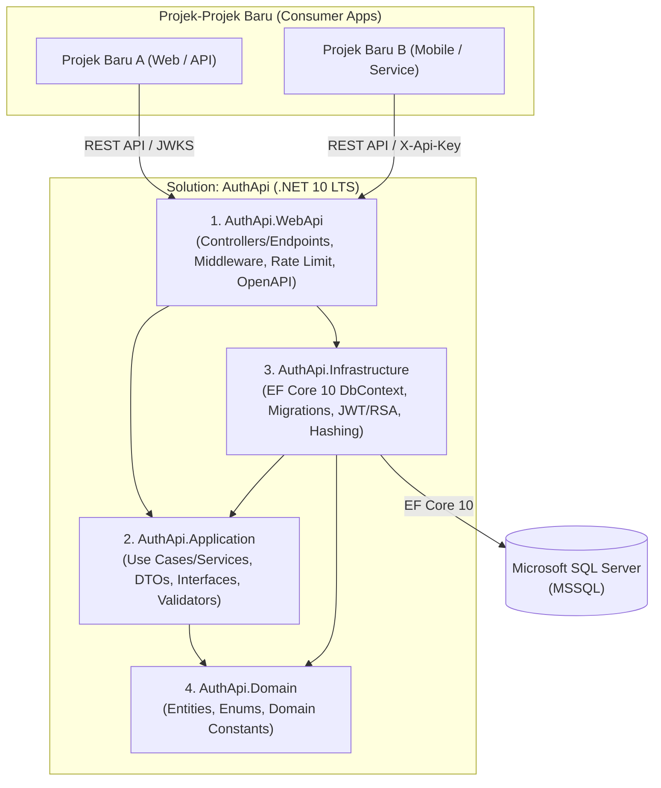
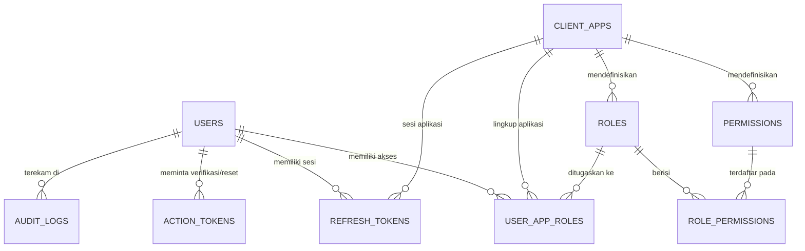

# Dokumen Perencanaan Sistem — Centralized Auth API (`auth-api`)

> **Target Pembaca Dokumen Ini:** Junior Programmer & Model AI Eksekutor.  
> **Tingkat Instruksi:** High-Level Architecture & Execution Blueprint.  
> Ikuti batasan teknologi, arsitektur, aturan keamanan, dan urutan fase di dokumen ini secara berurutan. Jangan melompati fase dan jangan menambahkan fitur di luar *scope* tanpa persetujuan.

---

## 1. Visi & Tujuan Sistem

`auth-api` adalah layanan **Authentication (AuthN)** dan **Authorization (AuthZ)** terpusat berbentuk RESTful Web API.  
Tujuan utamanya adalah menjadi **pondasi tunggal pengelolaan identitas dan hak akses** sehingga setiap kali ada projek atau aplikasi baru di masa depan, aplikasi baru tersebut **tidak perlu membangun fitur user, login, dan permission dari nol** — cukup mendaftarkan aplikasinya dan memanggil endpoint `auth-api`.

### Prinsip Bisnis Utama
1. **Single User Pool (SSO Terpusat):** Satu pengguna hanya memiliki **satu akun global** yang dapat digunakan lintas projek/aplikasi.
2. **Isolasi Hak Akses per Aplikasi (`ClientApp`):** Meskipun akun bersifat global, hak akses (**Role** dan **Permission**) diatur secara spesifik untuk masing-masing aplikasi yang terdaftar. User yang menjadi `Admin` di Aplikasi A belum tentu memiliki akses ke Aplikasi B.
3. **Integrasi Mudah Lintas Platform:** Menggunakan endpoint REST JSON standar dan token **JWT Asymmetric (RS256 + JWKS)** ditambah endpoint verifikasi langsung, sehingga mudah dikonsumsi oleh backend maupun frontend apapun (.NET, Node.js, Go, Python, Web SPA, Mobile).

---

## 2. Standar Teknologi Wajib (Tech Stack)

Seluruh implementasi **WAJIB** mematuhi spesifikasi versi berikut:

| Komponen | Spesifikasi Wajib | Catatan Penting untuk Developer / Model AI |
| :--- | :--- | :--- |
| **Framework Utama** | **ASP.NET Core Web API — .NET 10 LTS (`net10.0`)** | Gunakan **versi tertinggi (latest patch/feature release `10.0.x`)** dari lini LTS **.NET 10**. **DILARANG** downgrade ke `.NET 8` / `.NET 9` atau memakai versi non-LTS (STS seperti `.NET 11`). Kunci SDK major version `10` melalui `global.json` dengan `rollForward: latestFeature`. |
| **ORM** | **Entity Framework Core 10 (`10.0.*` tertinggi)** | Gunakan paket `Microsoft.EntityFrameworkCore.SqlServer` dan `Microsoft.EntityFrameworkCore.Design` versi stabil `10.0.x` paling mutakhir dengan pendekatan **Code-First Migrations**. |
| **Database** | **Microsoft SQL Server (MSSQL)** | Seluruh skema, indeks unik, dan relasi dikelola melalui EF Core Migrations. |
| **Token & Kriptografi** | **JWT RS256 (RSA Asymmetric) + Opaque Refresh Token** | Gunakan `Microsoft.AspNetCore.Authentication.JwtBearer` (`10.0.*`). Publikasikan Public Key melalui standar endpoint `/.well-known/jwks.json`. |
| **Dokumentasi API** | **Built-in OpenAPI .NET 10 + Scalar UI** | Gunakan `Microsoft.AspNetCore.OpenApi` (`10.0.*`) dan `Scalar.AspNetCore` (standar modern .NET 10, hindari `Swashbuckle` lama yang sudah tidak menjadi default). |
| **Standar Error** | **RFC 9457 `ProblemDetails`** | Format error JSON seragam melalui Global Exception Handler bawaan ASP.NET Core. |

---

## 3. Arsitektur High-Level & Struktur Solution

Gunakan **Clean / Layered Architecture ringan (4 Project)** agar kode rapi, mudah diuji, dan mudah dipahami oleh junior programmer maupun model AI tanpa kerumitan berlebih:

### Pembagian Tanggung Jawab Layer
1. **`AuthApi.Domain`**: Berisi entitas data murni, enum (misal tipe token atau tipe audit event), dan aturan dasar domain. **Tidak boleh** memiliki referensi paket NuGet eksternal atau EF Core.
2. **`AuthApi.Application`**: Berisi kontrak/interface service, DTO Request & Response, validasi input, dan alur logika bisnis autentikasi/otorisasi. **Tidak boleh** bergantung langsung pada HTTP context atau SQL Server.
3. **`AuthApi.Infrastructure`**: Berisi `AppDbContext` EF Core 10, konfigurasi tabel (`IEntityTypeConfiguration`), folder `Migrations`, implementasi pembuatan JWT RS256, password/token hashing, serta pencatatan audit log ke database.
4. **`AuthApi.WebApi`**: Titik masuk aplikasi (`Program.cs`), konfigurasi Dependency Injection, Middleware keamanan, Rate Limiting, dan REST API Endpoints/Controllers yang tipis (*thin controllers* — hanya meneruskan request ke layer `Application`).

---

## 4. Desain Data Konseptual (Database Blueprint)

Jangan menggabungkan seluruh data dalam satu tabel besar. Buat skema relasional yang ternormalisasi di MSSQL dengan entitas inti berikut:

### Penjelasan Tabel Inti
1. **`Users`**: Menyimpan identitas tunggal user (`Id`, `Username` unik, `Email` unik, `PasswordHash`, `FullName`, `IsActive`, `IsAccountVerified`, `FailedLoginCount`, `LockoutEndUtc`, `CreatedAtUtc`, `UpdatedAtUtc`).
2. **`ClientApps`**: Daftar projek/aplikasi yang terhubung ke `auth-api` (`Id`, `ClientId`/kode unik misal `erp-core`, `Name`, `ApiKeyHash`, `ApiKeyPrefix` untuk identifikasi visual di admin, `AllowedOrigins`, `IsActive`, `CreatedAtUtc`).
3. **`Roles`**: Daftar role spesifik per aplikasi (`Id`, `ClientAppId`, `Name` misal `Admin` atau `FinanceStaff`, `Description`, `IsSystemRole`). Kombinasi `(ClientAppId, Name)` wajib unik.
4. **`Permissions`**: Daftar izin granular spesifik per aplikasi (`Id`, `ClientAppId`, `Code` misal `invoice.create`, `report.export`, `Description`). Kombinasi `(ClientAppId, Code)` wajib unik.
5. **`RolePermissions`**: Tabel penghubung *Many-to-Many* antara `Roles` dan `Permissions` (pastikan keduanya berasal dari `ClientAppId` yang sama).
6. **`UserAppRoles`**: Tabel penugasan *User* ke suatu *Role* pada `ClientApp` tertentu. Tabel inilah yang menentukan user boleh masuk ke aplikasi mana saja dan berperan sebagai apa.
7. **`RefreshTokens`**: Menyimpan sesi refresh token yang di-hash (`Id`, `UserId`, `ClientAppId`, `TokenHash`, `ExpiresAtUtc`, `CreatedAtUtc`, `CreatedByIp`, `UserAgent`, `RevokedAtUtc`, `ReplacedByTokenHash`, `RevokeReason`). Mendukung **Refresh Token Rotation**.
8. **`ActionTokens`**: Menyimpan token sekali pakai yang di-hash untuk **Aktivasi Akun** dan **Forgot/Reset Password** (`Id`, `UserId`, `Purpose` [`AccountActivation` / `PasswordReset`], `TokenHash`, `ExpiresAtUtc`, `UsedAtUtc`, `CreatedAtUtc`).
9. **`AuditLogs`**: Rekam jejak aktivitas keamanan *append-only* (`Id`, `TimestampUtc`, `UserId` nullable, `ClientAppId` nullable, `EventType`, `IsSuccess`, `IpAddress`, `UserAgent`, `DetailJson`).

---

## 5. Mekanisme Integrasi untuk Projek Baru

Projek baru yang ingin menggunakan `auth-api` cukup didaftarkan di tabel `ClientApps` untuk mendapatkan **`ClientId`** dan **`ApiKey`**, lalu dapat memilih salah satu (atau kombinasi) dari dua pola validasi berikut:

1. **Pola A — Validasi JWT Lokal Cepat (Direkomendasikan untuk Traffic Tinggi):**
   - User login ke `auth-api` menyertakan `clientId` aplikasi tujuan.
   - `auth-api` memverifikasi kredensial, memuat `roles` & `permissions` milik user **khusus untuk `clientId` tersebut**, lalu menerbitkan **Access Token (JWT RS256, umur pendek misal 15 menit)** dan **Refresh Token (umur panjang misal 7–14 hari)**.
   - Projek baru mengambil **Public Key** dari endpoint `GET /.well-known/jwks.json` (di-cache otomatis oleh library JWT standar) untuk memverifikasi keaslian token dan membaca klaim `sub`, `aud`, `roles`, serta `permissions` secara instan tanpa membebani jaringan di setiap request.
2. **Pola B — Validasi Realtime via Endpoint Introspection (`/api/v1/auth/verify`):**
   - Untuk transaksi kritikal (misal pencairan dana, penghapusan data penting, atau aplikasi yang tidak ingin memproses JWT sendiri), backend projek baru memanggil `POST /api/v1/auth/verify` dengan menyertakan `X-Client-Id` & `X-Api-Key` serta token user (dan opsional `requiredPermission`).
   - `auth-api` memastikan secara *realtime* ke database bahwa akun user belum diblokir, aplikasi masih aktif, dan permission masih berlaku detik itu juga.

---

## 6. Katalog Endpoint API (High-Level Contract)

Gunakan prefix versioning `/api/v1/...` sejak awal agar mudah dikembangkan di masa depan.

### A. Discovery & System Health
| Method & Path | Akses | Fungsi Utama |
| :--- | :--- | :--- |
| `GET /.well-known/jwks.json` | Publik | Menyediakan RSA Public Key dalam format standar JWKS agar projek lain bisa memverifikasi signature JWT RS256. |
| `GET /health` | Publik / Internal | Mengecek status hidup API dan konektivitas ke database MSSQL. |

### B. Public Authentication & Account Recovery (`/api/v1/auth`)
| Method & Path | Akses | Fungsi Utama |
| :--- | :--- | :--- |
| `POST /api/v1/auth/login` | Publik (Rate Limited) | Autentikasi `username/email` + `password` + `clientId`. Mengecek status akun & *lockout*, mencatat `AuditLog`, dan mengembalikan `accessToken`, `refreshToken`, serta profil ringkas. |
| `POST /api/v1/auth/refresh` | Publik (Rate Limited) | Menukar `refreshToken` valid dengan pasangan `accessToken` + `refreshToken` baru (*Refresh Token Rotation*). Jika mendeteksi pemakaian ulang token yang sudah dirotasi, cabut seluruh sesi aktif user tersebut. |
| `POST /api/v1/auth/logout` | Authenticated / Token | Mencabut (*revoke*) `refreshToken` yang sedang digunakan dan mencatat ke `AuditLog`. |
| `POST /api/v1/auth/activate-account/request` | Publik / Client API Key | Meminta pembuatan token aktivasi akun baru (disiapkan melalui abstraksi pengirim notifikasi). |
| `POST /api/v1/auth/activate-account/confirm` | Publik (Rate Limited) | Menukarkan token aktivasi sekali pakai untuk mengaktifkan status verifikasi akun user. |
| `POST /api/v1/auth/forgot-password` | Publik (Rate Limited) | Meminta token reset password sekali pakai (selalu kembalikan pesan generik sukses agar tidak membocorkan apakah email terdaftar atau tidak). |
| `POST /api/v1/auth/reset-password` | Publik (Rate Limited) | Validasi token reset password, perbarui `PasswordHash`, tandai token sudah terpakai, dan **cabut seluruh `RefreshTokens` lama** milik user. |

### C. Authenticated User & Consumer Verification (`/api/v1/auth`)
| Method & Path | Akses | Fungsi Utama |
| :--- | :--- | :--- |
| `GET /api/v1/auth/me` | Bearer JWT | Mengambil informasi profil user yang sedang login beserta daftar role & permission pada aplikasi terkait. |
| `POST /api/v1/auth/change-password` | Bearer JWT | Mengganti password menggunakan verifikasi `currentPassword` + `newPassword`, lalu mencabut sesi refresh token lain. |
| `POST /api/v1/auth/verify` | Client API Key (`X-Client-Id` + `X-Api-Key`) | Validasi realtime sebuah Access Token oleh backend aplikasi konsumen, sekaligus mengecek apakah user masih aktif dan memiliki `requiredPermission` tertentu. |
| `GET /api/v1/auth/permissions` | Bearer JWT atau Client API Key | Mengambil daftar terbaru `roles` dan `permissions` seorang user untuk `clientId` tertentu. |

### D. Administration & Provisioning (`/api/v1/admin`)
> Seluruh endpoint admin wajib dilindungi oleh permission tingkat administrator sistem (`auth-admin`) atau mekanisme Service API Key dengan hak *provisioning*.

| Kelompok | Endpoint Utama (High-Level) | Fungsi Utama |
| :--- | :--- | :--- |
| **Client Apps & API Keys** | `GET/POST/PUT /api/v1/admin/apps` `POST /api/v1/admin/apps/{id}/rotate-key` | Mendaftarkan projek baru, mengubah status aktif aplikasi, dan membuat/merotasi `ApiKey` (**nilai asli API Key hanya ditampilkan 1 kali pada response pembuatan/rotasi**). |
| **User Management** | `GET/POST/PUT /api/v1/admin/users` `POST /api/v1/admin/users/{id}/unlock` `POST /api/v1/admin/users/{id}/revoke-sessions` | Membuat/mengelola user terpusat, mengaktifkan/menonaktifkan akun, membuka kunci akun yang terkena *lockout*, dan memaksa logout dari seluruh perangkat/aplikasi. |
| **Roles & Permissions** | `GET/POST/PUT/DELETE /api/v1/admin/apps/{appId}/permissions` `GET/POST/PUT/DELETE /api/v1/admin/apps/{appId}/roles` `PUT /api/v1/admin/apps/{appId}/roles/{roleId}/permissions` | Mengelola katalog permission per aplikasi, membuat role per aplikasi, dan memetakan daftar permission ke dalam role. |
| **User Access Assignment** | `GET/PUT /api/v1/admin/users/{userId}/apps/{appId}/roles` | Menetapkan atau mencabut role seorang user pada aplikasi tertentu. |
| **Audit Logs** | `GET /api/v1/admin/audit-logs` | Membaca riwayat keamanan dengan dukungan pagination dan filter (`userId`, `clientId`, `eventType`, `dateFrom`, `dateTo`). |

---

## 7. Aturan Keamanan Wajib (Security Guardrails)

Setiap programmer atau model AI yang menulis kode di repo ini **WAJIB** mematuhi aturan berikut tanpa pengecualian:

1. **Zero Plain-Text Secrets di Database:**
   - **Password** wajib di-hash menggunakan algoritma *password hashing* modern dengan *salt* unik (misal `PasswordHasher<User>` standar ASP.NET Core / PBKDF2-SHA512 atau Argon2id).
   - **Refresh Token**, **Client API Key**, dan **Action Token (Reset/Activation)** wajib dibuat dari generator acak kriptografis (`RandomNumberGenerator`) dan **disimpan hanya dalam bentuk hash SHA-256** di database.
2. **Asymmetric Signing (RS256) untuk JWT:**
   - Gunakan pasangan RSA Private/Public Key (minimal 2048-bit) dengan `kid` (*Key ID*) agar mudah melakukan rotasi kunci di masa depan. Projek lain hanya boleh mengakses Public Key via JWKS, tidak boleh pernah berbagi Private Key.
3. **Klaim JWT Ramping & Terisolasi per Aplikasi:**
   - Isi klaim JWT hanya dengan informasi esensial (`sub`, `unique_name`, `email`, `aud` = `clientId`, `roles`, `permissions`, `jti`, `iat`, `exp`). Jangan memasukkan permission milik aplikasi lain ke dalam token aplikasi yang sedang diakses.
4. **Proteksi Brute-Force Berlapis:**
   - Terapkan **Account Lockout** pada level user (misal gagal login 5 kali berturut-turut mengunci akun selama 15 menit — angka dapat dikonfigurasi di `appsettings.json`).
   - Terapkan **Built-in ASP.NET Core Rate Limiting** berbasis IP pada endpoint publik sensitif (`/login`, `/forgot-password`, `/reset-password`, `/activate-account`, `/refresh`).
5. **Decoupled Notification untuk Token Aktivasi & Reset Password:**
   - Buat interface abstraksi (misal `IAuthNotificationDispatcher`) untuk mengirimkan token aktivasi dan reset password. Untuk tahap awal, sediakan implementasi *Development Logger / Webhook-ready stub* agar alur bisnis selesai secara utuh tanpa terikat keras ke satu vendor Email/WhatsApp tertentu.
6. **Kerahasiaan Konfigurasi:**
   - **DILARANG** menyimpan *Connection String* production berisi kredensial nyata atau *RSA Private Key* di dalam file yang di-commit ke Git. Gunakan `dotnet user-secrets` untuk lokal dan *Environment Variables* untuk server.

---

## 8. Batasan Scope (Out of Scope Saat Ini)

Agar pengerjaan tetap fokus, cepat selesai, dan tidak *over-engineered*, fitur berikut **SENGAJA TIDAK DIMASUKKAN** pada perencanaan fase ini (jangan dibuat kecuali ada instruksi baru):
- Two-Factor Authentication (2FA / TOTP / SMS OTP).
- Server protokol penuh OAuth2 / OpenID Connect (seperti *Authorization Code Flow with Consent Screen* / OpenIddict).
- Aplikasi Frontend / Web Dashboard UI (seluruh fungsi administrasi disediakan via REST API).
- Social Login pihak ketiga (Login with Google / Microsoft / Apple).

---

## 9. Roadmap Eksekusi Bertahap (Step-by-Step Phases)

> **Instruksi untuk Junior Programmer / Model AI Eksekutor:**  
> Kerjakan **SATU FASE** pada satu waktu. Jangan lanjut ke fase berikutnya sebelum kriteria selesai (*Definition of Done*) pada fase berjalan terpenuhi dan `dotnet build` berhasil tanpa *error*.

### Fase 1 — Inisialisasi Solution & Pondasi .NET 10 LTS
- Buat `.gitignore` standar .NET, `global.json` (mengunci lini SDK `.NET 10`), Solution, dan 4 project (`Domain`, `Application`, `Infrastructure`, `WebApi`) dengan `<TargetFramework>net10.0</TargetFramework>`.
- Konfigurasi referensi antar-project sesuai diagram arsitektur.
- Siapkan struktur `appsettings.json`, Global Exception Handling (`ProblemDetails`), `/health`, serta dokumentasi OpenAPI + Scalar UI di environment Development.
- **Definition of Done:** `dotnet build` sukses bersih, aplikasi berjalan, `/health` dan halaman Scalar OpenAPI dapat dibuka.

### Fase 2 — Pemodelan Domain, EF Core 10 & Migrasi MSSQL
- Buat seluruh entitas inti di `AuthApi.Domain`.
- Pasang EF Core 10 SQL Server di `AuthApi.Infrastructure`, buat `AppDbContext` dan konfigurasi relasi, tipe kolom, serta *unique index* untuk masing-masing tabel.
- Buat *Initial Migration* EF Core dan mekanisme **Database Seeder** awal saat startup/CLI untuk membuat:
  1. Aplikasi internal `auth-admin` di `ClientApps`.
  2. Permission & Role `SuperAdmin` bawaan.
  3. Akun `SuperAdmin` awal (kredensial awal diambil dari konfigurasi/environment, wajib diganti setelah bootstrap).
- **Definition of Done:** Migrasi berhasil dijalankan ke MSSQL, seluruh tabel beserta indeks terbentuk rapi, dan data *seed* awal masuk secara idempoten (aman dijalankan berulang).

### Fase 3 — Infrastruktur Keamanan, Kriptografi, JWT RS256 & Audit Log
- Implementasikan layanan hashing password, layanan hashing SHA-256 untuk token/API key, serta generator random token aman.
- Implementasikan manajemen RSA Key dan pembuatan Access Token JWT RS256 beserta endpoint publik `GET /.well-known/jwks.json`.
- Implementasikan layanan pencatatan `AuditLogs` yang mudah dipanggil dari seluruh *use case* autentikasi & administrasi.
- **Definition of Done:** Endpoint `/.well-known/jwks.json` menghasilkan struktur JSON JWKS standar yang valid dan token JWT yang dibuat berhasil diverifikasi menggunakan public key tersebut.

### Fase 4 — Core Authentication, Refresh Token Rotation & Account Lockout
- Implementasikan endpoint `POST /login`, `POST /refresh`, `POST /logout`, `GET /me`, dan `POST /change-password`.
- Terapkan logika perhitungan `FailedLoginCount`, penguncian sementara (`LockoutEndUtc`), deteksi pemakaian ulang *refresh token* yang sudah dirotasi, pencatatan `AuditLogs`, serta Rate Limiting pada endpoint publik.
- **Definition of Done:** Skenario login sukses, login gagal berulang hingga terkunci, rotasi refresh token, ganti password, dan logout teruji berjalan sesuai spesifikasi.

### Fase 5 — Alur Aktivasi Akun & Forgot/Reset Password
- Buat abstraksi `IAuthNotificationDispatcher` beserta implementasi default untuk development/logging.
- Implementasikan endpoint request & konfirmasi aktivasi akun serta `POST /forgot-password` & `POST /reset-password` menggunakan tabel `ActionTokens` (berbatas waktu & sekali pakai).
- Pastikan keberhasilan reset password otomatis mencabut seluruh `RefreshTokens` aktif milik user.
- **Definition of Done:** Alur aktivasi akun dan reset password selesai diuji dari pembuatan token hingga penukaran token, serta menolak token kedaluwarsa atau token yang sudah pernah dipakai.

### Fase 6 — Autentikasi Client API Key & Endpoint Integrasi Projek Konsumen
- Implementasikan mekanisme validasi header `X-Client-Id` + `X-Api-Key` (dicocokkan terhadap `ApiKeyHash` pada `ClientApps` yang aktif).
- Implementasikan endpoint `POST /api/v1/auth/verify` dan `GET /api/v1/auth/permissions` untuk kebutuhan validasi *realtime* dari aplikasi/projek lain.
- **Definition of Done:** Simulasi panggilan dari projek eksternal menggunakan `X-Client-Id` & `X-Api-Key` berhasil memverifikasi token user dan mengecek kepemilikan permission spesifik.

### Fase 7 — Endpoint Administrasi Lengkap (`/api/v1/admin/*`)
- Implementasikan aturan otorisasi berbasis permission pada endpoint admin.
- Bangun endpoint manajemen `ClientApps` (termasuk *rotate API key* yang hanya menampilkan raw key sekali), manajemen `Users` (termasuk *unlock* & *revoke sessions*), manajemen `Roles` & `Permissions` per aplikasi, penugasan role aplikasi ke user, serta pembacaan `AuditLogs` ber-pagination.
- **Definition of Done:** Siklus penuh pendaftaran projek baru -> pembuatan permission & role projek baru -> penugasan user -> user login ke projek baru dapat dilakukan 100% melalui endpoint API.

### Fase 8 — Pengujian Otomatis, Hardening & Panduan Integrasi Konsumen
- Tambahkan project pengujian (`AuthApi.Tests`) untuk menguji logika krusial (hashing, token rotation, lockout, isolasi permission antar aplikasi).
- Rapikan konfigurasi CORS dinamis/terkontrol, security headers, dan validasi input.
- Buat dokumen ringkas `INTEGRATION_GUIDE.md` berisi contoh praktis cara projek baru (.NET / non-.NET) menyambungkan autentikasi dan mengecek permission ke `auth-api`.
- **Definition of Done:** Seluruh test lulus (`dotnet test`), dokumentasi OpenAPI lengkap, dan panduan integrasi siap dipakai saat memulai projek baru.

