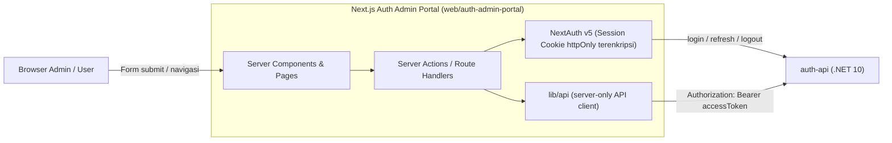
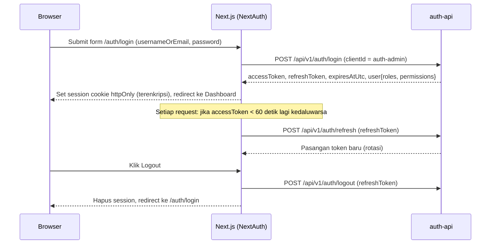

# Dokumen Perencanaan Frontend — Auth Admin Portal (`web/auth-admin-portal`)

> **Target Pembaca Dokumen Ini:** Junior Programmer & Model AI Eksekutor.  
> **Tingkat Instruksi:** High-Level Architecture & Execution Blueprint.  
> **Prasyarat:** Backend `auth-api` Fase 1–8 pada `PLANNING.md` sudah selesai dan ter-merge ke `main`.  
> Kerjakan fase secara berurutan. Jangan menambahkan fitur di luar *scope* tanpa persetujuan pemilik projek.

---

## 1. Visi & Tujuan

Membangun **Auth Admin Portal** berbasis Next.js sebagai antarmuka web resmi untuk layanan `auth-api`, dengan dua kelompok fungsi:

1. **Admin Portal (terproteksi):** Mengelola seluruh data identitas & hak akses lintas aplikasi — `ClientApps` & API Key, `Users`, `Permissions`, `Roles`, penugasan role per aplikasi, serta `AuditLogs`.
2. **Halaman Self-Service (publik):** Halaman yang dapat dipakai oleh **seluruh pengguna SSO dari aplikasi mana pun** — Lupa Password, Reset Password, dan Aktivasi Akun.

Portal ini sendiri adalah **konsumen `auth-api`** yang memakai `clientId = auth-admin`. Artinya hanya user yang memiliki Role pada aplikasi `auth-admin` yang dapat login ke portal.

---

## 2. Standar Teknologi Wajib (Mengikuti Template `rriawan/TEMPLATE_NEXT`)

| Komponen | Spesifikasi Wajib | Catatan |
| :--- | :--- | :--- |
| **Framework** | **Next.js 16 (App Router)** + **React 19** + **TypeScript** | Ikuti versi pada `package.json` template (Next `16.1.x`, React `19.2.x`) atau patch terbaru di major yang sama. Jangan turun ke Next 14/15. |
| **Runtime** | **Node.js LTS terbaru** | Minimal memenuhi syarat Next.js 16. Package manager: **npm** (template memakai `package-lock.json`). |
| **Styling & UI** | **Tailwind CSS v4** + **shadcn/ui** (style `new-york`, icon `lucide-react`) | Gunakan ulang komponen `components/ui/*`, layout, sidebar, header, breadcrumb, dan theme (light/dark) dari template. |
| **Autentikasi Portal** | **NextAuth (Auth.js) v5 — Credentials Provider** | Provider `Credentials` memanggil `POST /api/v1/auth/login` milik `auth-api`. **Hapus** provider Google & GitHub dari template (Social Login = Out of Scope). |
| **Proteksi Route** | `proxy.ts` (pengganti `middleware.ts` di Next 16) | Sudah tersedia di template, disesuaikan daftar route publiknya. |
| **Form & Validasi** | **react-hook-form** + **zod** | Aturan validasi wajib selaras dengan DTO backend (lihat Bagian 7). |
| **Notifikasi UI** | **react-hot-toast** | Untuk pesan sukses/gagal. |
| **Grafik (Dashboard)** | **ApexCharts** (`react-apexcharts`) | Hanya untuk dashboard ringkas. |

---

## 3. Arsitektur High-Level (Pola BFF — Backend for Frontend)



### Prinsip Wajib Arsitektur
1. **Token tidak pernah sampai ke browser.** `accessToken` dan `refreshToken` dari `auth-api` disimpan di dalam **JWT session NextAuth** (cookie `httpOnly`, terenkripsi `AUTH_SECRET`). Komponen client **tidak boleh** membaca token.
2. **Seluruh pemanggilan `auth-api` dilakukan di sisi server** (Server Components, Server Actions, atau Route Handlers) melalui satu modul `lib/api` yang ditandai `server-only`.
3. **Portal tidak memakai API Key `auth-admin` (`ak_admin_...`).** Seluruh endpoint admin dipanggil menggunakan **Bearer JWT milik admin yang sedang login**, sehingga setiap aksi tercatat di `AuditLogs` atas nama admin tersebut. API Key `auth-admin` tetap hanya untuk integrasi *machine-to-machine*.
4. **Otorisasi tetap ditegakkan oleh backend.** Penyembunyian menu/tombol berdasarkan permission di frontend hanya untuk kenyamanan UI, bukan pengganti keamanan.

---

## 4. Struktur Folder Proyek

Frontend ditempatkan di repo yang sama (monorepo):

```text
auth-api/
├── src/                         # Backend .NET 10 (sudah ada)
├── tests/                       # Test backend (sudah ada)
└── web/
    └── auth-admin-portal/       # Proyek Next.js (disalin & dibersihkan dari TEMPLATE_NEXT)
        ├── app/
        │   ├── auth/            # Halaman publik (login, forgot, reset, activate)
        │   ├── (dashboard)/     # Halaman terproteksi (layout sidebar template)
        │   └── api/auth/[...nextauth]/route.ts
        ├── components/          # ui/, layout/, shared/ dari template + komponen fitur
        ├── features/            # Komponen & server actions per modul (apps, users, roles, ...)
        ├── lib/
        │   ├── api/             # API client server-only + tipe DTO + mapper ProblemDetails
        │   ├── auth/            # Helper session, permission guard
        │   └── validation/      # Skema zod per form
        ├── auth.ts              # Konfigurasi NextAuth (Credentials -> auth-api)
        ├── proxy.ts             # Proteksi route
        └── .env.example         # Contoh variabel lingkungan (tanpa nilai rahasia)
```

> Halaman demo template yang **tidak relevan wajib dihapus** (crypto, nft, booking, chat, email, calendar, marketplace, wallet, widgets, charts demo, component showcase, register, social login, `utils/db.ts` dummy, dll.) agar proyek bersih dan mudah dipelihara.

---

## 5. Peta Halaman & Pemetaan Endpoint

### A. Halaman Publik (`/auth/*`) — Tidak Perlu Login
| Route | Fungsi | Endpoint `auth-api` |
| :--- | :--- | :--- |
| `/auth/login` | Login admin ke portal (`clientId` dikunci `auth-admin` di server, tidak tampil di form). | `POST /api/v1/auth/login` |
| `/auth/forgot-password` | Form email/username untuk meminta token reset. Selalu tampilkan pesan sukses generik. | `POST /api/v1/auth/forgot-password` |
| `/auth/reset-password?token=...` | Form password baru + konfirmasi. Token dibaca dari query string. | `POST /api/v1/auth/reset-password` |
| `/auth/activate-account` | Form meminta ulang token aktivasi. Pesan sukses generik. | `POST /api/v1/auth/activate-account/request` |
| `/auth/activate-account/confirm?token=...` | Konfirmasi aktivasi otomatis saat halaman dibuka, tampilkan hasil sukses/gagal. | `POST /api/v1/auth/activate-account/confirm` |

### B. Halaman Terproteksi (`(dashboard)`) — Wajib Login `auth-admin`
| Route | Fungsi | Endpoint `auth-api` | Permission Minimum |
| :--- | :--- | :--- | :--- |
| `/` (Dashboard) | Kartu ringkasan (jumlah aplikasi, user, aktivitas login gagal 24 jam) + tabel aktivitas terbaru. | `GET /admin/apps`, `GET /admin/users?pageSize=1`, `GET /admin/audit-logs` | `apps.read`, `users.read`, `audit-logs.read` |
| `/profile` | Profil admin login + daftar role/permission + tab Ganti Password. | `GET /auth/me`, `POST /auth/change-password` | (login saja) |
| `/apps` | Tabel aplikasi terdaftar + tombol "Daftarkan Aplikasi". | `GET/POST /admin/apps` | `apps.read` / `apps.write` |
| `/apps/[appId]` | Detail aplikasi dengan **tab**: *Informasi*, *Permissions*, *Roles*, *API Key*. | `GET/PUT /admin/apps/{id}` | `apps.read` / `apps.write` |
| Tab *API Key* | Tampilkan `apiKeyPrefix` + tombol "Rotasi API Key" (dialog konfirmasi). | `POST /admin/apps/{id}/rotate-key` | `apps.rotate-key` |
| Tab *Permissions* | CRUD permission milik aplikasi. | `GET/POST/PUT/DELETE /admin/apps/{appId}/permissions` | `permissions.read` / `permissions.write` |
| Tab *Roles* | CRUD role + dialog pemetaan permission (checkbox list). | `GET/POST/PUT/DELETE /admin/apps/{appId}/roles`, `PUT .../roles/{roleId}/permissions` | `roles.read` / `roles.write` |
| `/users` | Tabel user (search + pagination) + tombol "Tambah User". | `GET/POST /admin/users` | `users.read` / `users.write` |
| `/users/[userId]` | Detail & edit user, badge status (Aktif/Nonaktif/Terkunci/Belum Verifikasi), tombol **Unlock** & **Paksa Logout**, serta panel **Akses Aplikasi** (pilih aplikasi -> centang role). | `GET/PUT /admin/users/{id}`, `POST .../unlock`, `POST .../revoke-sessions`, `GET/PUT /admin/users/{userId}/apps/{appId}/roles` | `users.read`, `users.write`, `users.unlock`, `users.revoke-sessions` |
| `/audit-logs` | Tabel log keamanan dengan filter (user, clientId, eventType, status, rentang tanggal) + pagination + dialog detail `detailJson`. | `GET /admin/audit-logs` | `audit-logs.read` |

### C. Struktur Menu Sidebar (Mengganti `components/sidebar-data.ts` Template)
1. **Dashboard**
2. **Manajemen Akses:** Aplikasi (`/apps`), Pengguna (`/users`)
3. **Keamanan:** Audit Logs (`/audit-logs`)
4. **Akun Saya:** Profil & Password (`/profile`), Logout

Menu yang permission-nya tidak dimiliki user wajib disembunyikan.

---

## 6. Alur Autentikasi & Sesi Portal



### Aturan Wajib Sesi
1. **Efisiensi Ukuran Cookie Session NextAuth (< 4096 bytes):** Agar cookie terenkripsi NextAuth tidak melebihi batas `4 KB` browser, payload JWT NextAuth **hanya** menyimpan `accessToken`, `accessTokenExpiresAt`, `refreshToken`, serta profil ringkas `user` (`id`, `username`, `email`, `fullName`). Daftar `roles` dan `permissions` **tidak diduplikasi** di dalam cookie, melainkan diekstrak langsung dari klaim payload `accessToken` di sisi server saat membentuk objek `session.user`. Objek `session` yang dikirim ke komponen client **hanya** berisi data `user` (tanpa `accessToken` maupun `refreshToken`).
2. **Lokasi Eksekusi Refresh Token (Wajib di `proxy.ts` / Route Handler / Server Action):** Di Next.js App Router, Server Components bersifat *read-only* terhadap cookie (`Set-Cookie` tidak dapat ditulis saat render Server Component). Apabila rotasi `POST /api/v1/auth/refresh` terjadi di tengah render Server Component, `refreshToken` baru tidak akan tersimpan ke browser sehingga request berikutnya masih mengirim `refreshToken` lama dan memicu **Refresh Token Reuse Detection** (mencabut seluruh sesi admin). Oleh karena itu:
   - Pemeriksaan kedaluwarsa & pembaruan token otomatis **wajib dieksekusi di `proxy.ts` (middleware Next.js 16)** sebelum halaman dirender (serta diizinkan di dalam Server Actions / Route Handlers), lalu menulis ulang header `Set-Cookie` pada response.
   - Pemanggilan `auth()` di dalam Server Component hanya membaca token yang sudah dipastikan segar oleh `proxy.ts`.
3. **Cegah refresh ganda (*single-flight*).** Karena backend menerapkan *Refresh Token Reuse Detection*, dua refresh paralel memakai token yang sama akan **mencabut seluruh sesi user**. Implementasi refresh wajib memastikan hanya satu proses refresh berjalan per sesi pada satu waktu.
4. **Jika refresh gagal** (401/403), tandai session sebagai error lalu paksa logout & redirect ke `/auth/login` dengan pesan "Sesi berakhir, silakan login kembali."
5. **Permission di UI** dibaca dari `session.user.permissions`. Role `SuperAdmin` dianggap memiliki seluruh permission admin (selaras dengan filter backend).
6. **Durasi session cookie** tidak boleh melebihi umur refresh token backend (`RefreshTokenExpirationDays`, default 14 hari).

---

## 7. Aturan Penanganan Data, Error & Validasi

1. **Format error backend** adalah RFC 9457 `ProblemDetails` (`title`, `detail`, `status`, `traceId`). API client wajib memetakan error menjadi objek terstruktur dan menampilkannya lewat toast/alert:
   | Status | Perilaku UI |
   | :--- | :--- |
   | `400` | Tampilkan `detail` di form/toast. |
   | `401` | Paksa logout -> `/auth/login`. |
   | `403` | Tampilkan halaman/alert "Akses Ditolak" dengan `detail` dari backend (misal akun terkunci, belum verifikasi, tidak punya role). |
   | `404` | Tampilkan halaman "Data tidak ditemukan". |
   | `409` | Tampilkan `detail` (misal ClientId/Username/Email sudah dipakai). |
   | `429` | Tampilkan "Terlalu banyak percobaan, coba lagi nanti." |
   | `500` | Tampilkan pesan umum + `traceId` untuk dilaporkan. |
2. **Tipe TypeScript DTO** wajib disalin 1:1 dari DTO backend (`AuthDtos.cs`, `AdminDtos.cs`) dan dikumpulkan di `lib/api/types.ts`. Bila kontrak backend berubah, tipe ini wajib diperbarui pada PR yang sama.
3. **Validasi zod** wajib selaras dengan atribut backend, minimal:
   - Password baru: minimal 8, maksimal 256 karakter (+ konfirmasi password di frontend).
   - Username maks 100, Email valid maks 256, FullName maks 200.
   - `clientId` aplikasi: huruf kecil, angka, dan tanda `-` saja, maks 100 (backend menyimpan dalam huruf kecil).
   - Kode permission: huruf kecil dengan pola `modul.aksi` (contoh `invoice.create`), maks 150.
   - **Hapus aturan password template** (maks 15 karakter) karena bertentangan dengan backend.
4. **Setelah mutasi data** (create/update/delete), lakukan `revalidatePath` pada halaman terkait agar tabel langsung terbarui.
5. **Aksi destruktif** (hapus role/permission, rotasi API key, nonaktifkan aplikasi/user, paksa logout) wajib melalui **dialog konfirmasi**.

---

## 8. Aturan Keamanan Frontend (Security Guardrails)

1. **API Key sekali tampil:** `rawApiKey` dari respons `POST /admin/apps` dan `POST /admin/apps/{id}/rotate-key` hanya ditampilkan di **dialog modal** dengan tombol *Salin* dan peringatan "Kunci ini tidak akan ditampilkan lagi". Nilai tersebut **dilarang** disimpan di state global, URL, localStorage, cookie, maupun log.
2. **Dilarang menyimpan token** (`accessToken`/`refreshToken`) di `localStorage`, `sessionStorage`, atau cookie yang bisa dibaca JavaScript.
3. **Variabel lingkungan:** Hanya variabel non-rahasia yang boleh berawalan `NEXT_PUBLIC_`. `AUTH_SECRET` dan `AUTH_API_BASE_URL` wajib tanpa prefix tersebut. File `.env.local` wajib masuk `.gitignore`; sediakan `.env.example` tanpa nilai rahasia.
4. **Jangan menampilkan pesan yang membocorkan enumerasi akun** pada halaman publik (forgot password & aktivasi selalu menampilkan pesan sukses generik, sesuai perilaku backend).
5. **Security headers** di `next.config.ts`: `X-Frame-Options: DENY`, `X-Content-Type-Options: nosniff`, `Referrer-Policy: no-referrer`, serta `Content-Security-Policy` dasar.
6. **Tidak ada `dangerouslySetInnerHTML`** untuk data dari backend. Tampilkan `detailJson` audit log sebagai teks JSON yang di-*pretty print*.

---

## 9. Panduan Tampilan (Mengacu Template WowDash)

1. Gunakan **layout `(dashboard)`** template: sidebar collapsible, header (search, mode toggle light/dark, profile dropdown), breadcrumb, dan footer.
2. **Ganti branding**: logo/nama menjadi "Auth Admin Portal"; hapus dropdown notifikasi, pesan, dan pilihan bahasa dummy.
3. **Halaman login/forgot/reset/aktivasi** memakai layout `app/auth/layout.tsx` template (split panel ilustrasi + form).
4. **Tabel** memakai komponen `components/ui/table.tsx` + pagination template; sediakan *empty state* dan *loading skeleton* (`components/loading-skeleton.tsx`).
5. **Form create/edit** memakai `Dialog` atau `Sheet` shadcn untuk entitas sederhana (permission, role), dan halaman detail untuk entitas kompleks (aplikasi, user).
6. **Badge status** konsisten: Aktif (hijau), Nonaktif (abu-abu), Terkunci (merah), Belum Verifikasi (kuning), System Role (biru).
7. Seluruh teks antarmuka menggunakan **Bahasa Indonesia**.

---

## 10. Penyesuaian Kecil Backend yang Dibutuhkan

Karena seluruh request dari portal dikirim oleh server Next.js (pola BFF), beberapa penyesuaian backend diperlukan. Kerjakan pada **Fase F0** sebelum frontend:

1. **IP klien asli (WAJIB):** Saat ini Rate Limiting & `AuditLogs.IpAddress` membaca IP koneksi langsung. Dengan BFF, semua request terlihat berasal dari IP server Next.js — akibatnya rate limit login menjadi **bersama untuk semua admin** dan audit log kehilangan IP asli.
   - Portal wajib meneruskan IP & User-Agent asli melalui header `X-Forwarded-For` dan `User-Agent`.
   - Backend wajib mengaktifkan **ASP.NET Core Forwarded Headers Middleware** yang **hanya mempercayai** alamat proxy/server portal yang dikonfigurasi (`KnownProxies`/`KnownNetworks` di `appsettings`), lalu menggunakannya untuk Rate Limiting & Audit Log.
2. **Tautan pada notifikasi (DIREKOMENDASIKAN):** Tambahkan konfigurasi `Notification:PortalBaseUrl` agar `LoggingAuthNotificationDispatcher` (dan implementasi Email/WA di masa depan) mencetak tautan lengkap, misal `{PortalBaseUrl}/auth/reset-password?token=...` dan `{PortalBaseUrl}/auth/activate-account/confirm?token=...`.

> **Catatan:** Penambahan endpoint/fitur lanjutan seperti daftar user per aplikasi untuk aplikasi konsumen dan aksi reset password langsung oleh admin akan diatur pada dokumen perencanaan terpisah. Seluruh penyesuaian backend tetap wajib mematuhi `AGENTS.md` (verifikasi `dotnet build` + `dotnet test`, tanpa operasi database oleh AI). Tidak ada perubahan skema database pada fase ini.

---

## 11. Batasan Scope Frontend (Out of Scope)

- Registrasi mandiri (*Sign Up*) publik — pembuatan user hanya oleh admin.
- Social Login (Google/GitHub/Microsoft) dan 2FA/OTP.
- Halaman login SSO terpusat untuk aplikasi lain (*redirect-based SSO*). Aplikasi konsumen tetap memakai REST API sesuai `INTEGRATION_GUIDE.md`.
- Upload avatar, notifikasi realtime, multi-bahasa.

---

## 12. Roadmap Eksekusi Bertahap

> **Instruksi untuk Junior Programmer / Model AI Eksekutor:**  
> Kerjakan **SATU FASE** pada satu waktu. Setiap fase frontend dianggap selesai jika `npm run lint` dan `npm run build` di `web/auth-admin-portal` lulus tanpa error, serta skenario *Definition of Done* teruji manual terhadap `auth-api` yang berjalan di lokal.

### Fase F0 — Penyesuaian Backend untuk Pola BFF
- Implementasikan butir 1 dan 2 pada Bagian 10.
- Tambahkan/ubah test backend yang relevan.
- **Definition of Done:** `dotnet build` & `dotnet test` lulus; audit log mencatat IP asli saat request membawa `X-Forwarded-For` dari proxy tepercaya, dan mengabaikannya dari sumber tidak tepercaya.

### Fase F1 — Inisialisasi Proyek dari Template
- Salin isi `TEMPLATE_NEXT` ke `web/auth-admin-portal` (tanpa folder `.git`, `node_modules`, `.next`).
- Hapus seluruh halaman/komponen/aset demo yang tidak relevan (Bagian 4), provider Google/GitHub, halaman register, dan `utils/db.ts`.
- Ganti branding, susun ulang `sidebar-data.ts` sesuai Bagian 5C, buat `.env.example` (`AUTH_SECRET`, `AUTH_URL`, `AUTH_API_BASE_URL`, `AUTH_API_CLIENT_ID=auth-admin`).
- Pastikan `.gitignore` mengabaikan `node_modules`, `.next`, `.env*.local`.
- **Definition of Done:** `npm install`, `npm run lint`, `npm run build` lulus; aplikasi tampil dengan layout template yang sudah bersih.

### Fase F2 — Lapisan API Client & Tipe Kontrak
- Buat `lib/api` (server-only): fungsi `fetch` terpusat (base URL, header `Authorization`, `X-Forwarded-For`, `User-Agent`, timeout, `cache: 'no-store'`), parser `ProblemDetails`, dan kelas error terstruktur.
- Buat `lib/api/types.ts` berisi seluruh tipe DTO backend dan modul fungsi per domain (`authApi`, `appsApi`, `usersApi`, `rolesApi`, `permissionsApi`, `auditLogsApi`).
- Buat skema zod di `lib/validation` sesuai Bagian 7.
- **Definition of Done:** Seluruh fungsi API terketik penuh (tanpa `any`) dan build lulus.

### Fase F3 — Autentikasi Portal (NextAuth v5) & Proteksi Route
- Konfigurasi `auth.ts`: Credentials -> `POST /auth/login` (`clientId` dari env), callback `jwt` (simpan token tanpa duplikasi array `roles`/`permissions` di cookie + refresh single-flight), callback `session` (ekstrak `roles`/`permissions` dari `accessToken` dan ekspos hanya data user ke client).
- Sesuaikan `proxy.ts` (route publik: `/auth/login`, `/auth/forgot-password`, `/auth/reset-password`, `/auth/activate-account`) serta pastikan pemeriksaan/rotasi `refreshToken` terjadi di `proxy.ts` agar cookie `httpOnly` baru selalu tertulis ke response sebelum masuk ke Server Components.
- Halaman `/auth/login` (pesan error sesuai status backend: 401 kredensial salah, 403 terkunci/belum verifikasi/tidak punya akses, 429 rate limit).
- Logout memanggil `POST /auth/logout` lalu menghapus session.
- Buat helper `requirePermission()` untuk Server Components/Actions dan komponen `<Can permission="...">` untuk menyembunyikan elemen UI.
- **Definition of Done:** Login `superadmin` berhasil; akses halaman terproteksi tanpa login diarahkan ke `/auth/login`; sesi tetap hidup lewat refresh otomatis di `proxy.ts` setelah token kedaluwarsa tanpa memicu *Refresh Token Reuse Detection*; logout mencabut refresh token (terlihat di Audit Log).

### Fase F4 — Halaman Self-Service Publik
- `/auth/forgot-password`, `/auth/reset-password`, `/auth/activate-account`, `/auth/activate-account/confirm` sesuai Bagian 5A.
- **Definition of Done:** Alur forgot -> token (dari log backend) -> reset -> login dengan password baru berhasil; token terpakai/kedaluwarsa menampilkan pesan gagal yang jelas; alur aktivasi akun berhasil untuk user yang belum terverifikasi.

### Fase F5 — Profil & Ganti Password
- Halaman `/profile` (data `GET /auth/me`, daftar role & permission) + tab Ganti Password.
- Setelah ganti password sukses, paksa logout karena backend mencabut seluruh sesi.
- **Definition of Done:** Ganti password berhasil dan admin diarahkan login ulang dengan password baru.

### Fase F6 — Manajemen Aplikasi (ClientApps) & API Key
- Halaman `/apps` (tabel + dialog daftar aplikasi) dan `/apps/[appId]` tab *Informasi* & *API Key*.
- Dialog sekali-tampil `rawApiKey` (Bagian 8.1) untuk pembuatan & rotasi.
- Tampilkan peringatan khusus bahwa aplikasi `auth-admin` tidak dapat dinonaktifkan.
- **Definition of Done:** Aplikasi baru (misal `erp-core`) dapat didaftarkan, diedit, dinonaktifkan, dan dirotasi API key-nya dari UI.

### Fase F7 — Permissions & Roles per Aplikasi
- Tab *Permissions* (CRUD) dan tab *Roles* (CRUD + dialog pemetaan permission berbentuk checkbox).
- System Role ditandai badge, tombol hapus/ubah nama dinonaktifkan.
- **Definition of Done:** Permission & role untuk `erp-core` dapat dibuat, dipetakan, diubah, dan dihapus dari UI.

### Fase F8 — Manajemen User & Penugasan Akses
- Halaman `/users` (search, pagination, dialog tambah user) dan `/users/[userId]` (edit, Unlock, Paksa Logout, panel Akses Aplikasi).
- **Definition of Done:** Siklus penuh **daftarkan aplikasi -> buat permission & role -> buat user -> tugaskan role -> user login ke aplikasi tersebut** dapat dilakukan 100% dari portal (login aplikasi diuji via Scalar/`/api/v1/auth/login`).

### Fase F9 — Audit Logs & Dashboard
- Halaman `/audit-logs` dengan filter lengkap, pagination, dan dialog detail.
- Dashboard ringkas: kartu statistik + grafik login sukses/gagal 7 hari terakhir (diolah dari audit log) + tabel aktivitas terbaru.
- **Definition of Done:** Filter audit log bekerja sesuai parameter backend; dashboard tampil tanpa error untuk admin yang memiliki permission terkait, dan kartu tersembunyi bagi admin tanpa permission.

### Fase F10 — Hardening, Pengujian & Dokumentasi
- Security headers (Bagian 8.5), halaman `not-found`/`error`, *loading state* di seluruh halaman.
- Pengujian minimal: unit test skema zod & parser ProblemDetails; uji alur utama (login, CRUD aplikasi, penugasan role) secara manual atau end-to-end bila disetujui.
- Buat `web/auth-admin-portal/README.md` (cara instalasi, variabel lingkungan, menjalankan bersama `auth-api`).
- **Definition of Done:** `npm run lint` & `npm run build` lulus, seluruh skenario DoD F3–F9 terulang tanpa error, dokumentasi siap dipakai.

