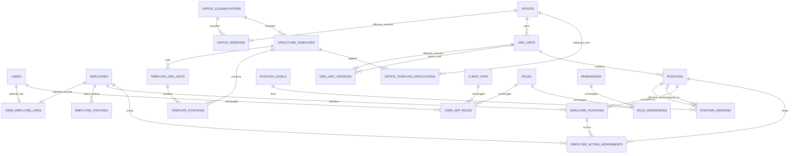

# Perencanaan Profil Pegawai dan Organisasi pada Auth API

Tanggal: 6 November 2026

Status: Blueprint usulan untuk review keputusan terbuka sebelum implementasi

Pembaca: pemilik proyek, pengembang, tester, dan AI coding agent

## 1. Ringkasan dan keputusan arah

Tambahkan master kantor, struktur organisasi, profil pegawai, dan riwayat penempatan pada `auth-api`, dengan mempertahankan authentication serta authorization terpusat yang sudah ada. Akun tetap global; role dan permission tetap diisolasi per `ClientApp`. Pengguna tetap membutuhkan role pada aplikasi tujuan untuk login.

Profil organisasi adalah data referensi. Jabatan, level, kantor, mutasi, promosi, maupun Plh./Plt. tidak otomatis memberikan atau mencabut role dan permission. Aplikasi konsumen tetap memeriksa permission di backend dan menjalankan aturan transaksi, pembatasan data, serta workflow approval miliknya.

Contoh ERP: pusat memberikan `payment.view` kepada Budi dan menyediakan profil bahwa Budi ditempatkan di Jakarta. ERP memeriksa permission tersebut, lalu menerapkan aturan internal mengenai pembayaran kantor mana yang boleh dilihat. Jika Budi mutasi, profil berubah; role pusat tetap sampai diubah administrator. ERP baru mengikuti kantor terbaru jika integrasinya secara eksplisit menerapkan aturan tersebut.

Dokumen ini menggantikan usulan pemindahan seluruh role/permission ke aplikasi konsumen dan usulan mesin authorization berbasis organisasi. Tidak ada perubahan source code atau database yang dilakukan saat penyusunan dokumen ini.

### 1.1 Label informasi

| Label | Arti |
|---|---|
| Existing | Terverifikasi dari file repository pada sesi analisis; bukan hasil inspeksi database berjalan |
| Requirement | Permintaan atau kesepakatan pengguna; aturan bisnis Word mengikuti status sumbernya |
| Recommendation | Desain yang diusulkan; bukan SOP perusahaan yang sudah disahkan |
| Open Decision | Keputusan belum tersedia; fase yang bergantung padanya harus menunggu keputusan |

### 1.2 Sumber dan urutan penggunaan

1. Kesepakatan terakhir pengguna: pertahankan authorization existing dan tambahkan profil pegawai/organisasi.
2. [AGENTS.md](../AGENTS.md), [PLANNING.md](../PLANNING.md), [PLANNING_FRONTEND.md](../PLANNING_FRONTEND.md), dan [STATUS.md](../STATUS.md).
3. Implementasi pada file yang dirujuk di bagian 2 sebagai sumber kebenaran teknis.
4. Lampiran pengguna `Aturan_Bisnis_Organisasi_dan_Jabatan_HRIS_v1.0.docx`, BRD-HRIS-ORG v1.0, tanggal 6 November 2026. Sumber asli berada di folder Downloads pengguna; tidak disalin ke repository. Dokumen berstatus DRAFT dan membedakan K (terkonfirmasi), R (rekomendasi), P (perlu keputusan). R/P tidak boleh dianggap SOP final.
5. Prompt terbaru pengguna tentang profil organisasi, diterapkan sejauh konsisten dengan kesepakatan terakhir. Larangan centralized business authorization pada prompt sebelumnya tidak menghapus RBAC existing yang kini disepakati tetap digunakan.

## 2. Analisis existing dan gap

| Area | Existing dan referensi | Perubahan yang direncanakan |
|---|---|---|
| Arsitektur | Empat project `src/AuthApi.Domain`, `Application`, `Infrastructure`, `WebApi`; EF melalui `IAppDbContext` | Tambahkan fitur pada layer yang sama, tanpa service atau solution baru |
| Akun | [User.cs](../src/AuthApi.Domain/Entities/User.cs): username, email, nama, status aktif/verifikasi, lockout | Relasi pegawai opsional; akun nonpegawai tetap valid |
| Aplikasi dan RBAC | [ClientApp.cs](../src/AuthApi.Domain/Entities/ClientApp.cs), [UserAppRole.cs](../src/AuthApi.Domain/Entities/UserAppRole.cs), `Role`, `Permission`, `RolePermission` | Tidak mengganti tabel maupun model penugasan existing |
| Login dan refresh | [AuthService.cs](../src/AuthApi.Application/Features/Auth/AuthService.cs): memuat role aplikasi dan menolak tanpa role | Pertahankan; tambahkan pemeriksaan status pegawai efektif hanya setelah aturan disahkan |
| JWT | [JwtTokenService.cs](../src/AuthApi.Infrastructure/Security/JwtTokenService.cs): RS256, audience aplikasi, role/permission | Tidak menambah hierarki/penempatan ke JWT pada rilis awal |
| Verifikasi | `VerifyTokenRealtimeAsync` membaca status akun dan akses terbaru; `/auth/permissions` menyediakan role/permission pusat | Pertahankan semantik RBAC; bukan endpoint aturan nominal, scope kantor, atau approval |
| Profil API | [AuthDtos.cs](../src/AuthApi.Application/Features/Auth/DTOs/AuthDtos.cs), `/auth/me`: profil akun dan role/permission | Endpoint profil organisasi baru, tanpa mengganti DTO existing |
| User admin | [AdminService.cs](../src/AuthApi.Application/Features/Admin/AdminService.cs), [AdminDtos.cs](../src/AuthApi.Application/Features/Admin/DTOs/AdminDtos.cs) | Tambahkan pengaitan pegawai; jangan mengubah role melalui operasi profil |
| Persistence | [AppDbContext.cs](../src/AuthApi.Infrastructure/Persistence/AppDbContext.cs), [IAppDbContext.cs](../src/AuthApi.Application/Common/Interfaces/IAppDbContext.cs) | Belum ada master kantor, pegawai, unit, posisi, atau penempatan |
| Admin authorization | [RequireAdminPermissionAttribute.cs](../src/AuthApi.WebApi/Infrastructure/RequireAdminPermissionAttribute.cs): klaim JWT `auth-admin` atau API key `auth-admin` | Endpoint baru perlu pemeriksaan status dan permission terbaru, termasuk untuk perubahan sensitif |
| Portal | `web/auth-admin-portal/app/(dashboard)/users/[userId]/page.tsx`, `components/users/*`, `app/(dashboard)/profile/page.tsx` | Tambah tab organisasi/histori, halaman master dan pegawai; pertahankan tab akses aplikasi |
| BFF | `auth.ts`, `proxy.ts`, `lib/api/*`, `lib/auth/*` | Gunakan server-only API client dan cookie httpOnly existing |
| Pengujian | `tests/AuthApi.Tests/*`: fixture EF InMemory | Tambahkan tes bisnis/keamanan; InMemory tidak membuktikan constraint atau locking SQL Server |

Catatan existing penting:

- `SetUserAppRolesAsync` mengganti semua role user untuk satu aplikasi. Operasi ini tetap administratif dan tidak dipanggil otomatis oleh mutasi/penempatan.
- Penonaktifan user melalui `UpdateUserAsync` mencabut refresh token aktif. JWT yang masih valid dapat tetap diterima konsumen yang hanya memvalidasi signature/lifetime secara lokal.
- Filter admin existing membaca permission dari JWT; tidak ada access version yang diperiksa terhadap data terbaru. Blueprint ini tidak mengklaim revokasi JWT seketika.
- `global.json` yang diinspeksi berisi SDK `10.0.100`, `rollForward: latestFeature`. Catatan STATUS lama menyebut `10.0.403`; versi SDK terpasang dan paket terpulihkan belum diverifikasi. Jangan menyalin angka lama sebagai hasil verifikasi baru.

## 3. Scope dan arsitektur tanggung jawab

### 3.1 Masuk scope

- Master 28 kantor dan klasifikasinya, unit organisasi, posisi, level, serta template struktur operasional.
- Profil pegawai minimum, hubungan akun opsional, penempatan definitif, rangkap, Plh./Plt., dan histori efektif.
- Struktur dan atasan formal sebagai referensi; vacancy tetap terlihat.
- Endpoint admin, profil organisasi sendiri, halaman portal, audit, konkurensi, dan integrasi baca profil.
- Penanganan status resign terhadap login/refresh dan penonaktifan akun menurut keputusan eksplisit bagian 14.
- Dokumentasi keterbatasan JWT, pembaruan profil, dan kewajiban aplikasi konsumen.

### 3.2 Di luar scope

- Automatic role assignment, policy engine ABAC/organisasi, scoped grants, dan perubahan skema RBAC existing.
- Penentuan approver efektif, fallback approval, batas nominal, self-approval, dan eksekusi workflow.
- Payroll, absensi, cuti, remunerasi, data keluarga, rekening, dokumen identitas sensitif, dan upload berkas SK.
- OAuth2/OIDC penuh, social login, signup publik, 2FA, dan perubahan protokol login.
- Sinkronisasi dua arah HRIS, message broker, webhook, dan bulk directory konsumen pada rilis awal.

### 3.3 Pembagian tanggung jawab

| Komponen | Tanggung jawab |
|---|---|
| AuthN dan RBAC pusat | Validasi akun, login, token, role/permission per aplikasi, verifikasi realtime |
| Modul organisasi/pegawai | Fakta organisasi, periode penempatan, status pegawai, histori dan data referensi |
| ERP/HRIS/Keuangan | Pemeriksaan permission backend, scope data, nominal, transaksi, approval, serta sesi lokal |
| Admin organisasi | Pemeliharaan master dan penempatan sesuai permission internal `auth-admin` |

Gunakan .NET 10 LTS `net10.0`, EF Core 10 MSSQL Code-First, OpenAPI bawaan + Scalar, dan Next.js 16/React 19/TypeScript/Tailwind v4/shadcn/ui/NextAuth v5. Saat implementasi, verifikasi patch stabil terbaru pada lini yang diwajibkan; jangan downgrade atau memperkenalkan framework baru.

## 4. Aturan bisnis organisasi

### 4.1 Kantor dan template

Requirement K dari BRD:

- `OfficeCode` adalah string tiga digit; `000` tidak menjadi angka 0.
- Klasifikasi bukan nama kantor, level jabatan, wilayah, atau urutan hierarki.
- Setiap kantor memiliki struktur aktual dan personel sendiri.
- Jangan menyimpulkan induk kantor pemasar berdasarkan kode, nama, atau lokasi. Hubungan antarkantor adalah Open Decision.
- Kantor pusat memiliki pola umum Direktorat → Divisi → Bagian → Seksi → Pelaksana, tetapi rincian resminya belum lengkap. Jangan membuat unit pusat yang tidak diberikan perusahaan.

| Klasifikasi | Garis pelaporan posisi |
|---|---|
| CAB-I | Kepala Cabang → Kasi Pemasaran / Kasi Teknik / Kasi Keuangan, SDM, dan Umum. Pelaksana Pemasaran → Kasi Pemasaran; Pelaksana Akseptasi serta Klaim & Subrogasi → Kasi Teknik; Pelaksana Keuangan, SDM, dan Umum → Kasi terkait |
| CAB-II | Kepala Cabang → Kasi Pemasaran / Kasi Operasional. Pelaksana Pemasaran → Kasi Pemasaran; Pelaksana Akseptasi, Klaim & Subrogasi, Keuangan, SDM, dan Umum → Kasi Operasional |
| CAB-III | Kepala Cabang → Kasi Operasional dan Pelaksana Pemasaran. Pelaksana Akseptasi, Klaim & Subrogasi, Keuangan, SDM, dan Umum → Kasi Operasional |
| PEMASAR | Kepala Pemasar → Pelaksana Administrasi Pemasar / Pelaksana Keuangan Pemasar |

Recommendation: template adalah pola berversi yang disalin menjadi struktur aktual melalui preview dan konfirmasi admin. Penerapan memakai satu transaksi dan kunci idempotensi. Pengulangan request yang sama mengembalikan hasil sebelumnya, bukan menggandakan unit/posisi. Versi yang sudah dipublikasikan immutable; perubahan menghasilkan versi baru. Perubahan template tidak menimpa kantor aktif. Perubahan kelas atau reorganisasi memerlukan rencana efektif tersendiri dan pemeriksaan dampak penempatan.

### 4.2 Posisi, level, dan vacancy

- Pisahkan unit, posisi, level, dan orang. `PositionTrack = LINE | FUNCTIONAL` serta `IsUnitHead` terpisah dari level.
- Fungsional setara Kadiv tetap bukan Kepala Divisi dan tidak otomatis menerima permission pimpinan.
- Satu posisi Pelaksana dapat ditempati banyak pegawai. Jangan membuat posisi baru per pegawai.
- Vacancy dihitung dari tidak adanya pemegang definitif efektif pada tanggal pemeriksaan, bukan boolean yang diedit manual. Penugasan acting tidak menghapus fakta bahwa posisi tidak memiliki pemegang definitif.
- Tidak hadir/cuti bukan vacancy. Modul ini tidak menghitung ketersediaan pegawai atau delegasi approval.
- Garis pelaporan formal tetap mengarah ke posisi vacant. API tidak melompati posisi kosong menuju kepala kantor sebagai approver.
- Rekomendasi kapasitas pimpinan: satu pemegang definitif efektif; pelaksana dapat banyak. Batas rangkap dan pengecualian transisi menunggu D-04.
- Cegah cycle pada unit dan posisi untuk seluruh rentang tanggal yang terdampak, termasuk perubahan masa depan. Relasi lintas kantor ditolak pada baseline; pengecualian menunggu keputusan eksplisit.

### 4.3 Pegawai dan penempatan

- Requirement: akun dapat tidak terhubung dengan pegawai; pegawai juga dapat belum memiliki akun.
- Recommendation: satu akun terhubung maksimal satu pegawai dan satu pegawai maksimal satu akun. Akun layanan tidak otomatis dianggap pegawai.
- Nomor pegawai unik sebagai string; jangan mengasumsikan format, panjang, atau leading zero tanpa aturan perusahaan. Baseline panjang maksimum usulan 50 karakter.
- Jabatan definitif utama, rangkap definitif, dan acting disimpan terpisah dari master posisi. Contoh Kasi Aktuaria menjadi Plh. Kasi Statistik: penempatan Aktuaria tidak ditimpa.
- Semua periode menggunakan awal inklusif dan akhir eksklusif `[effectiveFrom, effectiveToExclusive)`; akhir null berarti belum ditentukan. UI menerjemahkan tanggal akhir inklusif pengguna menjadi akhir eksklusif hari berikutnya.
- Recommendation zona waktu bisnis: `Asia/Jakarta`; tanggal efektif menggunakan SQL `date`/DateOnly. Waktu audit menggunakan UTC `datetime2`. Keputusan D-03 mengunci konvensi sebelum kode dibuat.
- Satu penempatan utama definitif efektif untuk pegawai yang sudah ditempatkan. Pegawai baru boleh belum ditempatkan dan ditampilkan sebagai incomplete, bukan diberi posisi fiktif.
- Plh./Plt. harus mempunyai posisi target, rentang, jenis, referensi keputusan, dan pencatat. Status usulan `DRAFT | CONFIRMED | CANCELLED`; status ini hanya publikasi data penugasan, bukan persetujuan transaksi ERP. Detail legal penunjukan menunggu D-04.
- Mutasi menutup penempatan lama dan membuka yang baru secara atomik. Promosi dicatat sebagai alasan perubahan penempatan, bukan mengubah level seluruh pemegang posisi lama.
- Pembatalan/koreksi menyimpan versi sebelumnya, alasan, dan pelaku. Tidak menghapus histori atau mengubah role.
- Penugasan acting menyimpan referensi penempatan asal. Bila asal berakhir sebelum acting, tolak perubahan sampai admin memilih penutupan atau pengaitan ulang yang sah; jangan menghapus acting diam-diam.

## 5. Master kantor awal

Requirement: nama dan klasifikasi berikut berasal dari Lampiran A BRD, bukan hasil inferensi. Jumlah adalah baseline saat ini, bukan constraint maksimum jumlah kantor.

| Kode | Nama resmi | Klasifikasi |
|---|---|---|
| 000 | KANTOR PUSAT | HEAD_OFFICE |
| 110 | CABANG SYARIAH ACEH | CAB-II |
| 111 | CABANG SYARIAH MEDAN | CAB-II |
| 112 | CABANG SYARIAH PADANG | CAB-III |
| 113 | CABANG SYARIAH PEKANBARU | CAB-II |
| 114 | PEMASAR SYARIAH JAMBI | PEMASAR |
| 115 | PEMASAR SYARIAH PALEMBANG | PEMASAR |
| 116 | PEMASAR SYARIAH BENGKULU | PEMASAR |
| 117 | PEMASAR SYARIAH LAMPUNG | PEMASAR |
| 119 | PEMASAR SYARIAH LHOKSEUMAWE | PEMASAR |
| 220 | CABANG SYARIAH JAKARTA | CAB-I |
| 221 | CABANG SYARIAH BANDUNG | CAB-II |
| 222 | CABANG SYARIAH SEMARANG | CAB-III |
| 223 | PEMASAR SYARIAH YOGYAKARTA | PEMASAR |
| 224 | CABANG SYARIAH SURABAYA | CAB-II |
| 225 | PEMASAR SERANG | PEMASAR |
| 226 | PEMASAR SYARIAH CIREBON | PEMASAR |
| 227 | PEMASAR SYARIAH TASIKMALAYA | PEMASAR |
| 228 | PEMASAR SYARIAH KEDIRI | PEMASAR |
| 330 | CABANG SYARIAH PONTIANAK | CAB-III |
| 331 | PEMASAR SYARIAH PALANGKARAYA | PEMASAR |
| 332 | PEMASAR SYARIAH BANJARMASIN | PEMASAR |
| 333 | CABANG SYARIAH SAMARINDA | CAB-III |
| 440 | PEMASAR SYARIAH MANADO | PEMASAR |
| 441 | PEMASAR SYARIAH PALU | PEMASAR |
| 443 | CABANG SYARIAH MAKASSAR | CAB-II |
| 550 | PEMASAR SYARIAH BALI | PEMASAR |
| 551 | CABANG SYARIAH MATARAM | CAB-II |

Rekap: 1 HEAD_OFFICE, 1 CAB-I, 7 CAB-II, 4 CAB-III, 15 PEMASAR, total 28. `ParentOfficeId` belum diisi berdasarkan asumsi. Data awal disiapkan sebagai artefak provisioning idempoten pada fase implementasi; penerapannya hanya oleh pengguna. Jangan menjalankan seed saat menyusun planning atau saat startup default.

## 6. Desain data konseptual

Seluruh tabel berikut adalah Recommendation baru, kecuali `Users` dan tabel RBAC existing. Gunakan database dan DbContext existing. Jangan menambah master perusahaan/multitenancy tanpa kebutuhan baru.

### 6.1 Entitas dan relasi

| Entitas | Atribut inti dan tujuan |
|---|---|
| `OfficeClassifications` | Code PK, DisplayName; lima kode baseline |
| `Offices` | Id PK, OfficeCode unique, RowVersion; identitas stabil |
| `OfficeVersions` | Id, OfficeId FK, Name, ClassificationCode FK, IsActive, rentang efektif, revision metadata |
| `OrgUnits` | Id, OfficeId FK, UnitCode, RowVersion; identitas unit aktual |
| `OrgUnitVersions` | Id, OrgUnitId FK, ParentOrgUnitId nullable FK, UnitType, Name, IsActive, rentang efektif |
| `PositionLevels` | Id, Code unique, Name, DisplayOrder; urutan tampilan tidak memberikan hak bisnis |
| `Positions` | Id, OrgUnitId FK, PositionCode, RowVersion; identitas posisi aktual |
| `PositionVersions` | Id, PositionId FK, Name, LevelId FK, Track, IsUnitHead, ReportsToPositionId nullable FK, MaxIncumbents nullable, IsActive, rentang efektif |
| `Employees` | Id, EmployeeNumber unique, EmployeeFullName, RowVersion, CreatedAtUtc, UpdatedAtUtc |
| `EmployeeStatuses` | Id, EmployeeId FK, StatusCode, rentang efektif, alasan; katalog status final menunggu D-02 |
| `EmployeePositions` | Id row revisi, AssignmentKey logis, EmployeeId FK, PositionId FK, IsPrimary, rentang efektif, ChangeReason, DecisionReference, RecordState, RevisionNumber dan superseded metadata |
| `EmployeeActingAssignments` | Id row revisi, AssignmentKey logis, EmployeeId FK, SourceEmployeePositionId FK revisi definitif milik pegawai yang sama, TargetPositionId FK, Type PLH/PLT, rentang efektif, DecisionReference, RecordState dan metadata revisi |
| `UserEmployeeLinks` | UserId PK/FK, EmployeeId unique FK, LinkedAtUtc, LinkedByUserId; hubungan opsional 1:1 |
| `StructureTemplates` | Id, ClassificationCode FK, Version, State, catatan; unique classification/version |
| `TemplateOrgUnits` | Id, TemplateId FK, UnitCode, ParentTemplateOrgUnitId, UnitType, Name |
| `TemplatePositions` | Id, TemplateId FK, TemplateOrgUnitId FK, Code, Name, level, track, head, capacity, ReportsToTemplatePositionId |
| `OfficeTemplateApplications` | Id, OfficeId FK, TemplateId FK, EffectiveFrom, IdempotencyKey unique per kantor, AppliedBy; bukti penerapan template |

Identitas `OrgUnits.OfficeId` dan `Positions.OrgUnitId` tidak dipindahkan ke kantor/unit lain secara in-place. Reorganisasi yang memindahkan kepemilikan membuat identitas baru dan menutup yang lama; nama, parent, klasifikasi, serta garis pelaporan menggunakan versi efektif. Ini menjaga referensi historis tetap bermakna.

Semua record yang dapat dikoreksi menyimpan Created/Updated UTC, actor, alasan, dan revision/RowVersion. Versi efektif memisahkan waktu berlaku bisnis dari waktu input. Untuk koreksi, record lama ditandai superseded melalui metadata revisi dan disimpan; query bisnis hanya memakai revisi current. Riwayat link akun juga diaudit dengan snapshot old/new. Tidak perlu SQL temporal table pada tahap awal; jika dipilih kemudian, temporal tidak menggantikan tanggal efektif bisnis.

Ketentuan implementasi P2A: satu AssignmentKey memiliki satu row revisi current, dengan unique (AssignmentKey, RevisionNumber). DRAFT hanya untuk assignment baru; jangan menyupersede penempatan confirmed dengan draft revisi. Revisi confirmed dipublikasikan atomik pada P2B, termasuk penanganan seluruh acting current yang menunjuk row sumber lama. Validasi kapasitas harus menggunakan timeline versi posisi, bukan kapasitas saat ini saja. Detail langkah ada di [panduan P2A](ORGANIZATION_P2A_EMPLOYEE_FOUNDATION.md).

### 6.2 ERD



### 6.3 Constraint, indeks, dan konkurensi

- Gunakan Guid PK; kode kantor `varchar(3)` dengan validasi tepat tiga digit; nama `nvarchar(200)` sebagai batas teknis usulan.
- Unique OfficeCode; unique (OfficeId, UnitCode); unique (OrgUnitId, PositionCode); unique EmployeeNumber; unique EmployeeId pada link akun. Tidak ada unique PositionId global pada penempatan.
- FK restrictive untuk master/histori, tanpa cascade delete riwayat. Arsip melalui versi/status, bukan DELETE record yang pernah dipakai.
- Check akhir > awal, MaxIncumbents null atau > 0, enum/state sah, parent bukan dirinya sendiri. Satu head position aktif per unit dan kapasitas incumbent divalidasi lintas rentang setelah D-04 disahkan.
- Interval current untuk satu office/unit/position/status tidak overlap. Validasi penempatan utama, kapasitas, dan acting memperhitungkan seluruh periode, bukan hanya hari ini.
- Indeks: (OwnerId, EffectiveFrom, EffectiveToExclusive) pada versi/status; (EmployeeId, EffectiveFrom, EffectiveToExclusive), (PositionId, EffectiveFrom, EffectiveToExclusive) pada penempatan; target dan periode pada acting; indeks seluruh FK.
- Unique index biasa tidak cukup mencegah overlap tanggal. Gunakan transaksi SQL Server dengan penguncian identitas induk sebelum membaca rentang. Lock pegawai untuk primary/status, posisi untuk kapasitas, serta kantor untuk perubahan struktur. Urutan lock konsisten; operasi lintas objek memperoleh seluruh lock yang diperlukan sebelum validasi.
- RowVersion mencegah lost update tetapi tidak menggantikan lock pemeriksaan rentang. Berikan ETag opaque; mutation existing resource wajib `If-Match`, stale menghasilkan 412, tanpa precondition 428. Konflik aturan bisnis menghasilkan 409.
- Perubahan data, revisi, dan audit keberhasilan harus satu transaksi. Saat ini interface DbContext hanya mengekspos SaveChanges; tambahkan abstraksi unit-of-work transaksi pada Application dan implementasi SQL di Infrastructure, bukan SQL langsung di use-case.

## 7. Identitas, nama, dan siklus hidup akun

### 7.1 Nama dan hubungan akun

Recommendation: `Users.FullName` tetap nama tampilan akun untuk kompatibilitas. `Employees.EmployeeFullName` adalah nama master pegawai. Endpoint baru menampilkan kedua field dengan label berbeda. Jangan otomatis menimpa Users saat link/ubah pegawai. UI menyediakan koreksi eksplisit yang diaudit bila pemilik proyek memilih penyelarasan; D-01 menentukan otoritas final sebelum implementasi edit nama.

NIP, kantor, jabatan, dan unit tidak disalin menjadi kolom teks pada Users. Link/unlink tidak menambahkan role, tidak membuat akun diam-diam, dan tidak mengubah status aktif. Link hanya terhadap pegawai sah; untuk pegawai resign, penautan/reaktivasi ditolak sampai status dan kebijakan dipenuhi. Perubahan link memerlukan audit dan permission khusus; unlink tidak boleh menjadi cara menghindari pembatasan resign.

Baseline menyimpan link akun saat ini, bukan link bertanggal efektif. Untuk endpoint admin profil user, parameter `asOf` merekonstruksi organisasi **pegawai yang terhubung saat ini**, bukan siapa pegawai yang dahulu terhubung ke akun. Response admin wajib menyertakan `linkResolution: CURRENT` dan tanggal pengaitan. Setelah relink dari pegawai A ke B, query user dengan asOf masa lalu tetap menanyakan organisasi B pada tanggal itu; bila B belum mempunyai penempatan, hasilnya kosong. Riwayat hubungan A/B diperiksa melalui audit link, dan histori organisasi A melalui endpoint employee A. Jangan memasarkan kontrak ini sebagai snapshot historis identitas akun. Link bertanggal efektif baru dirancang jika kebutuhan tersebut disetujui terpisah.

### 7.2 Resign dan tanggal efektif

Requirement: resign yang berlaku harus mencegah login baru dan refresh bagi akun terkait. Akun nonpegawai mengikuti aturan akun existing.

Recommendation untuk D-02:

1. Simpan status pegawai efektif, jangan mengubah `Users.IsActive` saat memasukkan resign yang baru berlaku di masa depan.
2. Saat tanggal resign tercapai, login, refresh, verifikasi realtime, dan endpoint baru memeriksa status efektif pegawai melalui link. Penolakan tidak boleh bergantung hanya pada job background.
3. Proses lifecycle yang dijalankan operator secara eksplisit menonaktifkan akun dan mencabut refresh token saat efektif, mencatat audit secara idempoten. Rancang perintah aplikasi untuk dijalankan pengguna; tidak ada startup seed/migrate atau eksekusi database oleh AI. Kebutuhan scheduler operasional harus diputuskan sebelum rilis.
4. Jika proses lifecycle terlambat, pemeriksaan status tetap menolak login/refresh/realtime; tampilkan keterlambatan di operasional. Konsumen JWT lokal tetap memiliki jendela stale.
5. Resign tidak menghapus UserAppRoles atau histori. Masuk kembali tidak otomatis mengaktifkan akun atau memulihkan sesi; perlu tindakan admin dan pemeriksaan akses lama.
6. Tolak unlink/relink bila pegawai asal mempunyai status pembatas CONFIRMED yang berlaku sekarang **atau dijadwalkan pada masa depan**, termasuk resign. Operator harus terlebih dahulu membatalkan/mengoreksi keputusan status melalui prosedur resmi D-02 dengan alasan dan audit; operasi link tidak dapat membatalkannya. Ini berlaku walau akun belum nonaktif dan tanggal resign belum tercapai. Pengecekan link, status, dan perubahan dilakukan atomik dengan lock pegawai/user agar tidak balapan dengan penjadwalan resign. Unlink/relink yang sah tidak mengaktifkan akun atau memulihkan refresh token.

Aturan status selain ACTIVE/RESIGNED, tanggal terakhir bekerja, penanganan akun khusus, dan retensi belum merupakan SOP; fase lifecycle diblokir sampai D-02/D-03 disetujui. Jangan menebak bahwa cuti atau tidak ada penempatan berarti akun harus diblokir.

## 8. Rancangan REST API

Seluruh endpoint di bagian ini adalah Recommendation baru. Endpoint auth/RBAC existing beserta DTO-nya tetap tersedia. Gunakan `/api/v1`, ProblemDetails existing, pagination default 20 maksimum 100, filter eksplisit, dan batas kedalaman hierarki maksimum usulan 32.

### 8.1 Profil konsumen dan profil sendiri

| Method dan path | Akses | Kontrak |
|---|---|---|
| GET `/api/v1/auth/me/organization` | Bearer valid | Profil organisasi akun sendiri efektif hari ini; userId berasal dari `sub`, client dari `aud` |
| GET `/api/v1/auth/me/organization/reporting-line` | Bearer valid | Garis posisi atasan formal milik penempatan sendiri; parameter assignmentId harus dimiliki user |
| GET `/api/v1/admin/users/{userId}/organization` | Permission `employees.read` dan `users.read` pada auth-admin | Profil pegawai pada link akun saat ini, opsional `asOf=YYYY-MM-DD` untuk organisasi pegawai itu; bukan histori link akun |
| GET `/api/v1/admin/employees/{id}/history` | `employees.history.read` | Histori status/penempatan dan koreksi sesuai hak admin |

Profil sendiri tidak menerima userId atau asOf arbitrer dan tidak menyediakan daftar seluruh pegawai. Akun tanpa link mengembalikan 200 dengan employee null dan assignments kosong; bukan error login. Assignment kosong pada pegawai berbeda dari tidak ada link.

Endpoint konsumen wajib memvalidasi signature/issuer/lifetime, audience terhadap ClientApp aktif, status/verifikasi/lockout akun, role aplikasi terbaru, dan status pegawai efektif menurut D-02. Untuk endpoint ini, permission bisnis seperti `payment.view` bukan syarat baca profil sendiri. Token aplikasi lain tidak boleh dipakai untuk operasi admin.

Contoh bentuk response (nilai demonstrasi, bukan master pegawai aktual):

```json
{
  "userId": "11111111-1111-4111-8111-111111111111",
  "accountDisplayName": "Budi Santoso",
  "asOf": "2026-11-06",
  "businessTimeZone": "Asia/Jakarta",
  "profileVersion": "opaque-composite-version",
  "nextEffectiveChangeAtUtc": null,
  "employee": {
    "id": "22222222-2222-4222-8222-222222222222",
    "employeeNumber": "00123",
    "employeeFullName": "Budi Santoso",
    "status": "ACTIVE"
  },
  "primaryAssignmentId": "33333333-3333-4333-8333-333333333333",
  "assignments": [
    {
      "id": "33333333-3333-4333-8333-333333333333",
      "type": "DEFINITIVE",
      "isPrimary": true,
      "effectiveFrom": "2026-01-01",
      "effectiveToExclusive": null,
      "office": { "id": "44444444-4444-4444-8444-444444444444", "code": "220", "name": "CABANG SYARIAH JAKARTA", "classification": "CAB-I" },
      "orgUnit": { "id": "55555555-5555-4555-8555-555555555555", "name": "Keuangan, SDM, dan Umum" },
      "position": { "id": "66666666-6666-4666-8666-666666666666", "name": "Pelaksana Keuangan, SDM, dan Umum", "track": "LINE", "levelCode": "PELAKSANA", "isUnitHead": false },
      "formalSupervisor": { "positionId": "77777777-7777-4777-8777-777777777777", "positionName": "Kepala Seksi Keuangan, SDM, dan Umum", "isVacant": true }
    }
  ]
}
```

Jangan menyertakan NIP/nama/identitas pegawai atasan lain pada endpoint sendiri secara default. Reporting-line menampilkan posisi dan vacancy, bukan approver. Rilis directory orang lain memerlukan D-06 dan kontrak terpisah. Tidak ada field `effectivePermissions`, `approvalAuthority`, atau scope transaksi pada response profil ini.

### 8.2 Administrasi master dan pegawai

| Kelompok endpoint | Operasi dan permission minimum |
|---|---|
| `/api/v1/admin/organization/classifications` | GET katalog; `organization.read` |
| `/api/v1/admin/organization/offices` | GET/POST; `organization.read` / `organization.write` |
| `/api/v1/admin/organization/offices/{id}` | GET; `organization.read` |
| `/api/v1/admin/organization/offices/{id}/versions` | POST revisi bertanggal efektif termasuk arsip; `organization.write` |
| `/api/v1/admin/organization/units`, `/positions` | GET/POST identitas + versi awal; GET `{id}` dan POST `{id}/versions`; permission organisasi terkait |
| `/api/v1/admin/organization/position-levels` | GET/POST, PUT `{id}`; read/write organisasi; perubahan semantik level yang dipakai harus memakai kode baru |
| `/api/v1/admin/organization/offices/{id}/structure?asOf=...` | GET pohon unit dan posisi; `organization.read` |
| `/api/v1/admin/organization/templates` | GET/POST draft; GET `{id}`, PUT `{id}` draft, POST `{id}/publish`; `organization.templates.read/write` |
| `/api/v1/admin/organization/offices/{id}/template-preview` | POST templateId/tanggal; read template + organisasi |
| `/api/v1/admin/organization/offices/{id}/template-application` | POST hasil preview/version + Idempotency-Key; `organization.templates.write` + `organization.write` |
| `/api/v1/admin/employees` | GET/POST; `employees.read` / `employees.write` |
| `/api/v1/admin/employees/{id}` | GET/PUT identitas dasar; read/write pegawai |
| `/api/v1/admin/employees/{id}/assignments` | GET/POST definitif; read / `employees.assignments.write` |
| `/api/v1/admin/employees/{id}/transfers` | POST tutup/buka penempatan atomik; `employees.assignments.write` |
| `/api/v1/admin/employees/{id}/acting-assignments` | GET/POST; read / `employees.assignments.write` |
| `/api/v1/admin/employees/{id}/assignments/{assignmentId}/revisions` | POST koreksi/penutupan/pembatalan dengan alasan; `employees.assignments.write` |
| `/api/v1/admin/employees/{id}/acting-assignments/{actingId}/revisions` | POST koreksi/konfirmasi/penutupan/pembatalan; `employees.assignments.write` |
| `/api/v1/admin/employees/{id}/status-changes` | POST perubahan status efektif; `employees.lifecycle.write` |
| `/api/v1/admin/users/{userId}/employee-link` | PUT EmployeeId; DELETE unlink; `employees.link.write` + `users.write` |

Semua ID turunan divalidasi terhadap parent route untuk mencegah akses silang. Template draft memakai payload unit/posisi dengan kode referensi lokal; publish memvalidasi relasi, cycle, klasifikasi, dan kelengkapan; tidak langsung membuat posisi kantor.

Contoh request mutasi:

```json
{
  "sourceAssignmentId": "33333333-3333-4333-8333-333333333333",
  "targetPositionId": "88888888-8888-4888-8888-888888888888",
  "effectiveFrom": "2026-12-01",
  "changeReason": "TRANSFER",
  "decisionReference": "SK-CONTOH-001",
  "reason": "Penempatan baru sesuai keputusan perusahaan"
}
```

Wajib If-Match atas versi agregat pegawai. Response 201 memuat ID operasi, versi agregat baru, assignment lama/baru dan tanggal, serta `rolesChanged: false`. Input kantor/unit target tidak diterima sebagai sumber kebenaran terpisah dari PositionId. Konflik periode/kepemilikan/acting diselesaikan sebelum commit; seluruh perubahan dibatalkan jika salah satu gagal.

### 8.3 Keamanan endpoint baru

- Permission baru hanya milik `auth-admin`; tidak diberikan otomatis kepada user yang sekadar `users.read`. Provisioning permission dan pemetaan SuperAdmin dilakukan melalui prosedur idempoten oleh pengguna.
- New admin endpoints memakai guard yang memeriksa user aktif, audience auth-admin, serta role/permission terbaru sebelum menerima operasi. Perilaku SuperAdmin internal tetap konsisten. Guard baru dapat digunakan ulang; jangan diam-diam mengubah kontrak endpoint lama pada fase profil.
- Jalur API key `auth-admin` existing adalah kredensial provisioning kuat. Recommendation rilis awal: endpoint baru hanya menerima Bearer admin; machine provisioning baru ditunda sampai hak layanan dirancang. API key konsumen tidak dapat mengubah organisasi/pegawai atau mengambil bulk profil.
- Semua permission yang tercantum dengan tanda `+` wajib dipenuhi bersama, bukan salah satu.
- Rate limit, cancellation, validasi panjang, ProblemDetails, dan audit diterapkan. 401 autentikasi gagal, 403 hak tidak cukup, 404 record tidak ada, 400 input invalid, 409 konflik bisnis, 412/428 precondition, 429 rate limit.

## 9. Alur kerja dan integrasi

### 9.1 Login dan baca profil

1. Aplikasi login dengan username/password/clientId melalui endpoint existing.
2. Pusat memeriksa akun, status pegawai efektif yang disahkan, dan role khusus aplikasi; menerbitkan JWT/refresh dengan kontrak existing.
3. Backend aplikasi memvalidasi JWT dan membaca profil melalui `/auth/me/organization` menggunakan token user tersebut.
4. Aplikasi menggunakan permission untuk tindakan dan profil sebagai referensi aturan lokal. Profil bukan bukti bahwa user berwenang menyetujui transaksi.
5. Pengguna tanpa link pegawai tetap bisa login jika memenuhi aturan akun dan role aplikasi.

### 9.2 Mutasi, promosi, dan acting

1. Admin memilih pegawai, posisi target, tanggal efektif, dan dasar keputusan.
2. Backend memvalidasi versi, rentang, kapasitas, status, struktur efektif, serta penugasan terkait.
3. Commit data/histori/audit atomik. Future-dated record belum mengganti profil hari ini.
4. Saat tanggal berlaku, pembacaan profil menghasilkan penempatan baru tanpa perlu job untuk mengubah current office.
5. Roles, RolePermissions, dan UserAppRoles tidak dimodifikasi. Admin mengubah akses secara terpisah jika diperlukan.
6. Acting berakhir menurut rentang baca efektif. Tidak ada pemberian/pencabutan permission otomatis dari acting. UI harus memperingatkan bahwa role manual tidak mengikuti akhir acting.

### 9.3 Vacancy dan approval

Atasan formal vacant tetap ditampilkan kosong. Ketentuan BRD tentang fallback ke kepala cabang/pemasar merupakan referensi untuk aplikasi pemilik workflow; tidak dieksekusi oleh auth-api. Keberadaan Plh./Plt. di profil hanya data penugasan dan tidak menjamin delegasi approval. Aplikasi menentukan pejabat efektif, nominal, prioritas, dan audit keputusan transaksi.

### 9.4 Pembaruan data dan cache

Recommendation awal: baca profil langsung dan conditional polling per user, tanpa change feed global. JWT, respons login, dan cookie session tidak ditambah seluruh profil.

- `profileVersion`/ETag adalah hash opaque atas hasil profil efektif beserta versi seluruh dependensinya: link, status, penempatan, posisi, unit, kantor, level, dan reporting-line yang dikembalikan. RowVersion Employees saja tidak memadai.
- Seluruh query pembentuk profil, pemeriksaan akses terkait, dan ETag menggunakan satu transaksi baca konsisten serta satu nilai waktu evaluasi yang ditangkap di awal. Baseline menggunakan isolasi SERIALIZABLE dengan query terindeks dan transaksi singkat; jangan menggabungkan hasil dari sebelum/sesudah commit mutasi. Validasi contention/deadlock pada SQL Server; retry baca harus terbatas. Alternatif snapshot isolation hanya boleh dipilih setelah konfigurasi dan dampaknya ditinjau pengguna, bukan diaktifkan otomatis oleh AI.
- Server menghitung ulang profil efektif sebelum mengevaluasi If-None-Match. Pergantian tanggal efektif harus mengubah representasi walau tidak ada write saat tengah malam.
- Response menggunakan `Cache-Control: private, no-cache` dan Vary Authorization; conditional request tetap harus lolos pemeriksaan status terkini sebelum menghasilkan 304.
- BFF tetap memakai fetch no-store; cache aplikasi lain hanya server-side dan dipisahkan user/client. Default awal rekomendasi maksimum 60 detik untuk tampilan umum, dibatasi lebih pendek oleh perubahan efektif berikutnya. Nilai ini harus disetujui D-07, bukan jaminan perusahaan.
- Untuk transaksi yang bergantung pada kantor/status terbaru, konsumen membaca ulang profil dan memanggil verify realtime tanpa cache sebelum eksekusi; transaksi tetap milik konsumen. Tidak ada atomic commit lintas database ERP/Auth; jika perlu jaminan kuat terhadap perubahan simultan, desain protokol transaksi tambahan di luar rilis ini.
- Kegagalan fetch tidak boleh diartikan profil kosong atau kewenangan diperluas. Transaksi sensitif yang memerlukan data terkini ditolak/ditunda saat pusat tidak tersedia.
- Endpoint `updatedSince` belum dibuat: timestamp sederhana bisa kehilangan perubahan dependensi, pembatalan, atau perubahan tanggal efektif. Jika kelak perlu feed, rancang cursor berbasis commit, tombstone, retry, otorisasi, retensi dan resync sebagai fase tersendiri.

### 9.5 Batas revokasi existing

Tidak menambah access version atau menghapus claim role/permission pada rilis awal. Verifikasi realtime harus membaca role dan status terbaru; konsumen memeriksa `isValid` serta `isAuthorized`, bukan HTTP 200 saja. JWT lokal yang valid masih dapat membawa permission lama sampai expiry ditambah toleransi clock validasinya. Sesi lokal ERP juga tidak otomatis hilang karena refresh pusat dicabut. D-07 wajib menentukan frekuensi pemeriksaan dan penanganan sesi masing-masing konsumen sebelum mengklaim SLA offboarding.

## 10. Perubahan Admin Portal

Pertahankan layout, pola BFF, login, tab akses aplikasi, dan pengelolaan role/permission existing.

| Halaman | Penambahan |
|---|---|
| `/users/[userId]` | Tab Organisasi: tautkan pegawai, ringkasan penempatan, status dan tautan detail pegawai. Tab Akses Aplikasi tetap terpisah |
| `/profile` | Ringkasan pegawai sendiri, kantor, unit, jabatan utama/tambahan dan tanggal berlaku; read-only |
| `/organization/offices` dan `/{id}` | Master kantor, versi efektif, struktur aktual, preview template |
| `/organization/templates` | Draft, validasi, publish versi template dan analisis penerapan |
| `/organization/units`, `/organization/positions`, `/organization/levels` | Pengelolaan master terkait dan versi efektif |
| `/employees` dan `/{id}` | Identitas, status, penempatan, mutasi/promosi, acting, dan histori |

Gunakan komponen dan folder fitur existing (`components/users/actions`, `lib/api`, `lib/validation`) sebagai pola; jangan membuat folder atau framework baru hanya karena contoh blueprint lama menyebut `features/`.

Tambahkan TypeScript DTO dan Zod selaras backend, dialog konfirmasi, tanggal efektif, alasan wajib, If-Match, dan tampilan konflik yang meminta reload. Tampilkan perbedaan vacant, belum ditempatkan, akun nonpegawai, jadwal masa depan, dan penugasan berakhir. Tampilkan pesan jelas bahwa perubahan profil tidak mengubah role.

Permission menu hanya untuk UX; backend tetap menegakkan guard. Token tetap di cookie httpOnly terenkripsi dan hanya dibaca server. Profil lengkap tidak dimasukkan ke session NextAuth. Preview struktur/histori tidak menggunakan HTML mentah. RevalidatePath setelah perubahan dan hindari shared caching profil pegawai.

## 11. Audit dan perlindungan data

- Reuse AuditLogs existing, perluas event type untuk create/revise/archive master, publish/apply template, link/unlink, transfer, acting, status pegawai, dan lifecycle akun.
- Audit memuat actorUserId, target employee/user, entity IDs, tanggal efektif, alasan, decision reference, correlation ID, hasil dan perubahan field minimum. UserId audit yang menunjuk subjek tidak boleh menggantikan identitas pelaku di detail.
- Simpan snapshot nama/kode versi yang relevan untuk interpretasi perubahan; jangan menulis seluruh profil atau rahasia ke log.
- Audit keberhasilan harus atomik dengan perubahan. Kegagalan audit tidak boleh menghasilkan mutasi tanpa jejak. Audit kegagalan dipisahkan dari transaksi yang rollback dan tidak membocorkan data kepada pemanggil.
- Akun nonpegawai tidak menerima histori pegawai lain. Jangan menggunakan NIP sebagai ID autentikasi atau rahasia. Jangan mengekspos data kepegawaian publik/JWKS.
- Link/unlink, status resign, dan pengubahan struktur merupakan operasi sensitif. Cegah privilege escalation melalui update user biasa, parameter userId, atau pergantian link.
- Retensi audit, histori, penghapusan/anonymization, serta batas akses HR versus admin teknis menunggu D-06/D-08. Tidak ada hard delete historis sebelum aturan retensi disahkan.

## 12. Alternatif desain dan pilihan utama

| Keputusan | Alternatif | Pilihan dan alasan |
|---|---|---|
| Integrasi pegawai | Kolom kantor/jabatan pada Users atau relasi terpisah | Relasi terpisah; mendukung nonpegawai, banyak penempatan dan histori |
| Role organisasi | Hitung role dari jabatan atau pertahankan RBAC manual | Pertahankan manual sesuai kesepakatan; tidak memperluas engine authorization |
| Baca profil | Semua data di JWT atau endpoint terpisah | Endpoint terpisah; JWT/cookie tetap ringkas dan profil dapat diperbarui |
| Histori | Overwrite master, temporal saja, atau versi efektif | Versi efektif + audit; membedakan waktu input dan berlaku bisnis |
| Integrasi | Broker/webhook atau polling profil | Polling per user lebih sederhana untuk awal; feed ditunda |
| Atasan | Resolusi approver atau data hierarki formal | Hierarki formal; approval tetap milik aplikasi |
| Penyimpanan | Database/layanan baru atau DbContext existing | DbContext existing; transaksi lokal dan perubahan minimal pada arsitektur |

Desain menambah beberapa tabel versi karena histori struktur dan klasifikasi merupakan kebutuhan nyata. Jangan menggantinya dengan pohon JSON tunggal yang sulit divalidasi atau menambah general-purpose workflow engine.

## 13. Tahapan implementasi dan risiko migrasi

Fase 1–8 backend dan F0–F10 frontend existing dianggap baseline historis; tidak diulang atau ditandai gagal. Ekstensi berikut diberi label P0–P7 dan dikerjakan satu per satu setelah instruksi implementasi baru. Dokumen ini bukan perintah menjalankan seluruh fase.

| Fase | Pekerjaan | Dependensi dan Definition of Done |
|---|---|---|
| P0 Keputusan dan kontrak | Selesaikan keputusan blocking bagian 14, inventaris consumer, review keamanan dan ERD, tetapkan DTO dan permission baru | Keputusan terdokumentasi; tidak ada asumsi SOP yang tersembunyi; review independen selesai |
| P1 Persistence dan master | Model/konfigurasi/versi/constraint, migration file, provisioning 28 kantor/klasifikasi dan template; tanpa data pegawai fiktif | P0 terkait master disetujui; migration ditinjau; build/test; pengguna menerapkan schema dan master lalu mengonfirmasi |
| P2 Profil dan penempatan | Pegawai, link opsional, status efektif, definitif/rangkap/acting, mutasi atomik, audit dan konkurensi | P1 diterapkan pengguna; tes rentang/kapasitas/koreksi; tidak mengubah RBAC |
| P3 API dan keamanan | Endpoint profil/admin/reporting-line, permission baru, guard fresh, ETag dan pagination | P2; uji penolakan akses, nonpegawai dan kompatibilitas kontrak lama |
| P4 Siklus hidup akun | Pemeriksaan status pada login/refresh/verify/new endpoints, lifecycle idempoten, aturan unlink dan rehire | D-02/D-03/D-07 disetujui; tidak mengganggu nonpegawai; operasional scheduler ditetapkan pengguna |
| P5 Portal | Master dan pegawai, tab organisasi/profil/histori, preview template, permission UI | API stabil; lint/build dan tes relevan; tab role existing tetap bekerja |
| P6 Pilot konsumen | ERP baca profil, conditional polling, verifikasi transaksi sensitif, status sesi lokal | D-07; uji mutasi/resign/availability bersama pemilik ERP; role tetap pusat |
| P7 Hardening dan dokumentasi | Review keamanan akhir, regresi auth/RBAC/BFF, dokumentasi API/integrasi/manual DB dan rollback | Semua gate selesai; risiko dan batas konsistensi diterima; STATUS diperbarui |

### 13.1 Aturan eksekusi dan migrasi

- AI boleh membuat file migration dengan `dotnet ef migrations add`, setelah memastikan design-time factory/startup tidak menjalankan seed atau operasi database. Tidak boleh menjalankan update/drop/remove migration, query server, seed, atau startup yang menyentuh database.
- Migrasi awal bersifat additive. Users existing tidak wajib mempunyai link; jangan mengisi pegawai/kantor secara perkiraan. Kaitan akun dan NIP hanya berdasarkan data perusahaan terverifikasi.
- Urutan deployment: pengguna meninjau backup/rollback → menerapkan schema additive → provisioning master/permission → backend baru → portal → pilot konsumen. Aktivasi lifecycle menunggu data link/status tervalidasi dan hasil pilot.
- Contoh perintah penerapan **hanya untuk dijalankan pengguna**, setelah nama migration dan konfigurasi environment diverifikasi:

```powershell
dotnet ef database update --project src/AuthApi.Infrastructure --startup-project src/AuthApi.WebApi
```

- Tunggu konfirmasi pengguna sesudah penerapan sebelum pekerjaan yang membutuhkan schema/data tersebut. Jangan mengubah connection string server atau menaruh kredensial pada dokumen/command.
- Rollback aplikasi mempertahankan tabel additive, tanpa DROP data histori. Backend lama mengabaikan status pegawai baru; rollback fase lifecycle tidak boleh dibuka ke trafik sebelum akun terdampak dinonaktifkan melalui prosedur pengguna. Jangan menjanjikan rollback aman hanya karena schema kompatibel.
- Risiko utama: link pegawai salah dapat memblokir akun yang salah; versi struktur tidak lengkap mengubah laporan historis; race menyebabkan overcapacity; data stale pada ERP; konsumen menganggap profil sebagai permission; role manual tetap ada setelah acting/resign. Mitigasi: preview, transaksi/lock, audit, data validation, offboarding gate, dan review akses manual.

### 13.2 Verifikasi yang wajib pada implementasi

Untuk perubahan backend: `dotnet build AuthApi.sln` dan `dotnet test AuthApi.sln`. Untuk frontend, dari `web/auth-admin-portal`: `npm run lint`, `npm run build`, serta test relevan. Sebelum menjalankan, pastikan hook/fixture tidak mengakses server database. Penyusunan dokumen ini tidak menjalankan build/test karena tidak ada perubahan source.

Tes InMemory hanya memverifikasi use-case. Constraint SQL Server, transaction isolation, rowversion dan race diuji pada lingkungan SQL Server terpisah oleh pengguna; AI menyiapkan skenario/skrip review, pengguna yang menjalankan operasi database. Jangan menyatakan integritas SQL tervalidasi hanya dari test InMemory.

## 14. Keputusan yang perlu dikonfirmasi

### 14.1 Keputusan pengguna pada awal implementasi

Pada 6 November 2026 pengguna mengonfirmasi:

- **D-01 disetujui:** master pegawai dikelola di auth-api, hubungan akun–pegawai opsional 1:1, nama tampilan akun dibedakan dari nama resmi pegawai.
- **D-03 disetujui:** zona waktu Asia/Jakarta; awal periode inklusif, akhir eksklusif; tanggal resign adalah hari pertama akun tidak boleh digunakan; koreksi tanggal lampau ditunda dari rilis awal.
- **D-02 disetujui setelah provisioning kantor:** rilis awal ACTIVE/RESIGNED; resign efektif menolak login/refresh; aktivasi kembali manual; role dipertahankan; unlink/relink ditolak bila ada resign berlaku atau terjadwal.
- **D-04 disetujui:** pimpinan maksimal satu pemegang definitif; Pelaksana multipegawai; kapasitas fungsional dikonfigurasi per posisi; satu jabatan utama dengan rangkap definitif tambahan; Plh./Plt. wajib referensi SK dan periode, tanpa perbedaan permission otomatis.
- **Scope awal D-05 disetujui:** mulai empat template operasional (CAB-I, CAB-II, CAB-III, PEMASAR) sebagai DRAFT. Struktur pusat, hubungan antarkantor dan pemetaan level Kepala Cabang/Kepala Pemasar ditunda sampai ada data resmi. Kode unit/posisi dalam katalog draft adalah kode teknis usulan, bukan klaim kode resmi perusahaan; semua LevelId template awal null sampai master level disahkan.
- **D-06 disetujui:** hak pegawai/organisasi granular dan hanya untuk SuperAdmin internal pada rilis awal; riwayat pegawai memakai permission terpisah; directory lintas user ditunda (detail pada tabel 14.2).
- D-05 masih parsial, D-07 dan D-08 belum diputuskan. P1/P0 keseluruhan tidak ditandai selesai sebelum gate terkait terpenuhi. P1A schema/master kantor telah diterapkan pengguna dengan hasil provisioning 5 klasifikasi, 28 kantor, 28 versi awal.

### 14.2 Daftar keputusan dan gate

Tanda blocking berarti fase terkait berhenti sebelum mengimplementasikan perilakunya; bagian independen tetap dapat direncanakan. Recommendation bukan persetujuan otomatis karena dokumen dibuat.

| ID | Keputusan dan rekomendasi awal | Gate |
|---|---|---|
| D-01 | Disetujui pengguna 6 November 2026: master di auth-api, link opsional 1:1, nama akun dan pegawai dibedakan | Terpenuhi untuk P2 dan edit profil |
| D-02 | Disetujui pengguna: ACTIVE/RESIGNED, resign efektif menolak login/refresh, aktivasi kembali manual, role dipertahankan, larangan unlink/relink saat resign berlaku/terjadwal | Terpenuhi untuk baseline P2; operasional scheduler/SLA tetap D-07 sebelum P4 go-live |
| D-03 | Disetujui pengguna 6 November 2026: Asia/Jakarta, awal inklusif/akhir eksklusif, resign hari pertama nonaktif, tanpa koreksi backdate rilis awal | Terpenuhi untuk penyimpanan periode P1/P2 |
| D-04 | Disetujui pengguna: kepala max1 definitif, Pelaksana multi, fungsional configurable, satu utama plus rangkap, acting wajib SK/periode tanpa automatic permission | Terpenuhi untuk baseline P2; tidak membuat pengecualian transisi kapasitas tanpa instruksi baru |
| D-05 | Empat template operasional DRAFT disetujui. Struktur pusat, hubungan kantor, master/pemetaan level yang belum resmi dan detail reorganisasi masih ditunda | P1B draft boleh disiapkan; publish/apply memerlukan kelengkapan master terkait |
| D-06 | Disetujui pengguna 6 November 2026: (1) permission `employees.*` dan `organization.*` dibuat granular tetapi pada rilis awal dipetakan hanya ke SuperAdmin internal `auth-admin`; role HR terpisah ditunda sampai ada instruksi baru, dan `users.read`/`users.write` tidak memberi hak pegawai. (2) `employees.history.read` adalah permission terpisah dari `employees.read` dan hanya dipegang pemegang hak pegawai pada butir 1. (3) Directory lintas user untuk konsumen ditunda: rilis awal hanya profil sendiri dan posisi atasan formal tanpa NIP/nama, serta tidak ada daftar pegawai/bulk profil untuk API key konsumen | Terpenuhi untuk hak endpoint/admin P3; directory dan role HR terpisah tetap di luar scope sampai instruksi baru |
| D-07 | SLA pembaruan profil dan offboarding, batas cache, pemeriksaan status sesi ERP, availability, scheduler lifecycle | Blocking go-live P4/P6; tidak ada janji revokasi JWT instan |
| D-08 | Retensi histori/audit dan koreksi backdate; referensi SK dan pembatasan data pribadi | Blocking kebijakan retensi/backdate; tidak ada hard delete |

Keputusan BRD P-04/P-06/P-07 tentang prioritas pengganti, eskalasi kepala kantor dan kewenangan transaksi tidak dibutuhkan untuk engine auth-api karena engine tersebut di luar scope. Tetap harus diputuskan pemilik workflow sebelum aplikasi konsumen mengimplementasikannya. Pemetaan grade/remunerasi tidak dimasukkan.

## 15. Acceptance criteria dan skenario pengujian

| ID | Skenario | Hasil yang wajib |
|---|---|---|
| AC-01 | Akun existing tanpa pegawai login/refresh | Tetap sesuai aturan akun dan role aplikasi; profil employee null |
| AC-02 | User tidak punya role ERP | Login dan refresh ERP tetap ditolak seperti existing |
| AC-03 | Role ERP berbeda dari aplikasi lain | JWT dan verify tetap terisolasi per audience/aplikasi |
| AC-04 | Master awal | Tepat 28 kode baseline, 1/1/7/4/15; 000 tetap string dan PEMASAR SERANG tidak diganti nama |
| AC-05 | CAB-I/II/III dan PEMASAR | Relasi posisi mengikuti bagian 4, terutama Pemasaran CAB-III langsung Kepala Cabang |
| AC-06 | Tiga pelaksana satu posisi | Berhasil tanpa menggandakan master posisi |
| AC-07 | Fungsional setara Kadiv | Bukan pimpinan otomatis dan tidak menerima permission baru |
| AC-08 | Atasan vacant | Posisi tetap ada; reporting-line tidak memutuskan approver/fallback |
| AC-09 | Definitif dan Plh. bersamaan | Utama tetap ada; acting tambahan bertanggal; tidak mengubah UserAppRoles |
| AC-10 | Acting berakhir | Tidak muncul aktif setelah batas eksklusif; histori tetap; role manual tidak berubah |
| AC-11 | Mutasi/promosi future-dated | Sebelum/sesudah tanggal menghasilkan profil yang tepat; tidak ada interval bocor |
| AC-12 | Koreksi klasifikasi/parent/posisi | Query asOf tetap memakai versi yang berlaku dan audit mempertahankan revisi sebelumnya |
| AC-13 | Dua admin mengisi kapasitas terakhir | Hanya satu perubahan valid yang commit pada SQL Server; konflik terkontrol |
| AC-14 | Dua penempatan utama overlap | Ditolak walau request bersamaan; interval berdampingan diperbolehkan |
| AC-15 | Cycle kini/masa depan atau parent lintas kantor | Ditolak; tidak menyisakan struktur parsial |
| AC-16 | ETag stale/tidak ada | 412/428; tidak overwrite perubahan lain |
| AC-17 | Terapkan template retry | Idempotent, tidak menggandakan unit/posisi; publish tidak mengubah kantor lain |
| AC-18 | Ganti profil/status/penempatan | Tabel RBAC tidak berubah; hak bisnis tetap dikelola pusat secara manual |
| AC-19 | Token ERP memanggil admin atau userId orang lain | Ditolak; API key konsumen tidak membuka akses master/history |
| AC-20 | Permission admin dicabut, JWT lama dipakai endpoint baru | Guard memeriksa akses terkini dan menolak; tes SuperAdmin dan akun nonaktif juga tersedia |
| AC-21 | Resign masa depan | Tidak memblokir lebih awal; pada tanggal efektif login/refresh/verify ditolak walau lifecycle job terlambat |
| AC-22 | Lifecycle retry dan rehire | Idempoten; refresh dicabut; rehire tidak mengaktifkan akun/sesi otomatis |
| AC-23 | Unlink sebelum resign masa depan atau relink ke pegawai aktif | Ditolak selama status pembatas confirmed belum dikoreksi sah; lifecycle terlambat tidak membuka login/realtime; sesi tidak dipulihkan |
| AC-24 | Cache dan pergantian tanggal | Profil berubah tanpa write baru; ETag dependency berubah; pemeriksaan status mendahului 304 |
| AC-25 | Pusat tidak tersedia | ERP tidak memperluas akses atau menganggap gagal fetch sebagai profil kosong; transaksi sensitif ditunda/ditolak |
| AC-26 | JWT lokal dan permission lama | Uji mendemonstrasikan jendela stale; dokumentasi tidak mengklaim revokasi seketika |
| AC-27 | Audit gagal saat transfer | Seluruh mutasi rollback; tidak ada setengah penempatan |
| AC-28 | Akhir penempatan asal acting | Ditolak sampai acting ditutup/dikoreksi sah; histori tetap |
| AC-29 | Portal | Form/guard konsisten, profil read-only, tab role existing tetap bekerja, token tidak terekspos |
| AC-30 | Regresi auth | Login, lockout, refresh rotation/reuse, reset/aktivasi, logout, API key, CRUD role/permission dan BFF tetap lulus |
| AC-31 | Profil user asOf setelah relink A ke B yang sah | Response menjelaskan link CURRENT; organisasi historis B dikembalikan, bukan mengklaim identitas akun historis A |
| AC-32 | Mutasi commit saat profil dibaca | Response dan ETag berasal dari satu keadaan konsisten, tidak mencampur kantor lama dan posisi baru |

## 16. Kriteria selesai pengembangan

Ekstensi hanya dinyatakan selesai setelah keputusan blocking fase terkait disahkan, schema diterapkan pengguna, skenario penerimaan dan pemeriksaan yang diwajibkan lulus dengan bukti aktual, review keamanan independen selesai, dokumentasi integrasi diperbarui, dan STATUS mencatat keterbatasan serta langkah manual yang tersisa. Persetujuan dokumen ini tidak mengizinkan AI menjalankan operasi database, commit, push, atau seluruh fase implementasi sekaligus.
